# Animation Station

🇳🇱 [Nederlandse versie](README.nl.md)

A small workstation for animating cardboard creatures with servo motors.
Eight faders on a Korg nanoKONTROL2 move eight servos live, and the movements can be **recorded** and **played back**, so a child can perform a creature, then film it in front of a green screen.

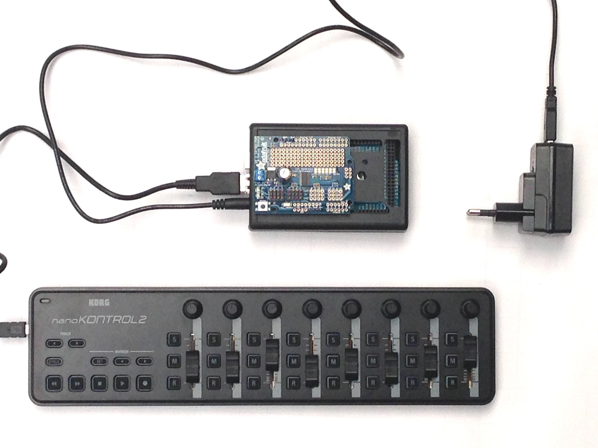

**Contents**

1. [The workshop idea](#1-the-workshop-idea)
2. [For children: how to make your creature move](#2-for-children-how-to-make-your-creature-move)
3. [For teachers: set-up, operation and fault finding](#3-for-teachers-set-up-operation-and-fault-finding)
4. [For technicians: construction, firmware, service and repair](#4-for-technicians-construction-firmware-service-and-repair)
   - [Part list](#41-part-list-per-station) · [3D-printed parts](#42-3d-printed-parts) · [Assembly and wiring](#43-assembly-and-wiring) · [Firmware](#44-firmware-platformio) · [How the firmware works](#45-how-the-firmware-works) · [Known limitations](#46-known-limitations-of-the-current-firmware) · [Service and repair](#47-service-and-repair) · [Repository layout](#48-repository-layout)

---

## 1. The workshop idea

1. Children build a **cardboard creature**.
2. They fix ready-made **servo modules** inside it with **split pins** (a servo module is a servo with a 3D-printed base plate and rotor, prepared in advance, see [§3.7](#37-servo-modules-preparing-and-servicing)).
3. The creature goes in front of a **green screen** and a camera.
4. The child performs the movements with the faders and **records** them, then **plays them back** while the camera runs.
5. Afterwards the green is replaced by a suitable background with a chroma-key app on a tablet.
6. At the end the servos are taken out of the creature again. Children take home **their creature and their movie**; the animation station and the servos stay.

Every station drives **8 servos**.

---

## 2. For children: how to make your creature move

> **Safety first**
> Craft knives are sharp and hot-glue guns are hot. Ask a grown-up when you need to cut or glue.
> Bend the legs of a split pin flat so they do not scratch anyone.

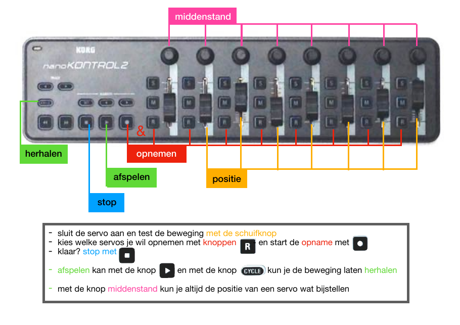

*The Dutch quick card for the table. Original files (PDF, Word, ePub) are in [`docs/quickcard-nl/`](docs/quickcard-nl/).*

### Plug in a servo

A servo has a plug with three wires. Plug it into the blue control box **colour on colour**: the **orange** (or yellow) wire to the top row, **red** in the middle, **brown/black** at the bottom row.
Servo plug 0 is moved by **fader 1** (the far left one), plug 1 by fader 2, and so on up to plug 7 and fader 8.

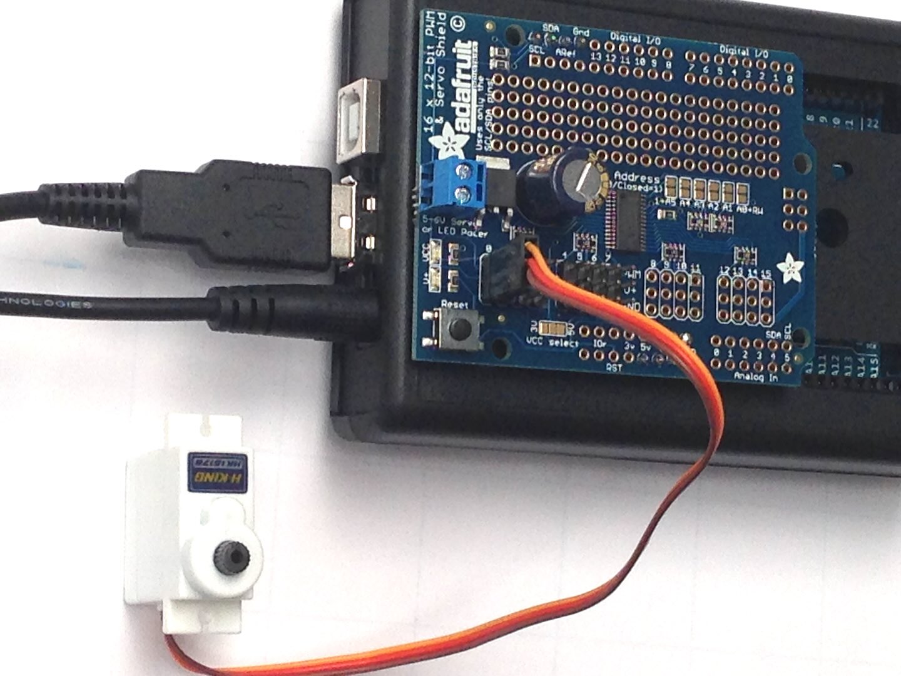

### Make it move

| I want to… | I do this |
|---|---|
| **Move a servo** | Push or pull its **fader** (the slider). |
| **Set the middle position** | Turn the **knob** above the fader. Handy to make the arm point exactly where you want. |
| **Choose what to record** | Press the **R** button under the fader of every servo you want to record. It lights up. |
| **Record** | Press **●** (the round button). Move the faders. You have **30 seconds**. |
| **Stop** | Press **■**. |
| **Play** | Press **▶**. Your movements are played back. |
| **Play again and again** | Press **CYCLE** before or during playing. Press it again to turn it off. |
| **Silence one servo** | Press **M** (mute) under its fader. |
| **Play only one servo** | Press **S** (solo). Press it again to hear/see them all again. |
| **Go through the recording step by step** | **◄◄** and **►►**. |

### Good to know

- **Wiggle all faders and knobs once** before you start. The box only knows where a fader is when you move it.
- Servos go **limp** a moment after you stop moving the faders. That is normal. You can then gently turn the part by hand.
- The **R** button must be lit for every servo you want recorded.
- The station remembers **one recording**. A new recording replaces the old one. Make your movie **before** the station is switched off.
- When the record light starts to **blink**, you have 5 seconds left.
- Small movements often look better than big ones.
- Something does not work? Do not pull on wires. **Ask a teacher.**

---

## 3. For teachers: set-up, operation and fault finding

### 3.1 What you need on the table

| Item | Notes |
|---|---|
| Control box (Arduino Mega ADK + servo shield in a black Hammond box) | with its power lead |
| Korg nanoKONTROL2 | connected to the box with a USB cable |
| USB wall adapter (5 V) | powers the box |
| 8 servo extension leads | for connecting the servos, connected on the servo shield |
| 8 **servo modules** (servo + glued base plate + screwed-on rotor), each with a servo extension lead | prepared in advance, see §3.7 |
| Split pins | for fixing the modules and moving parts in the cardboard |
| Spare servo modules, small screwdriver, spare screws, hot-glue gun | for quick repairs (§3.7) |
| Camera + green screen + tablet with a chroma-key app | for the film |

### 3.2 Setting up

1. Put the nanoKONTROL2 and the control box next to each other.
2. Connect the nanoKONTROL2 to the **USB-A socket** of the control box (the stacked USB port, not the square USB-B one).
3. Connect the USB-to-DC lead from the wall adapter to the round **power socket** of the control box and plug the adapter into the mains.
4. Plug the servos into channels **0 to 7** of the servo shield, colour on colour (signal/orange on top, red in the middle, brown/black at the bottom). Servo 0 belongs to fader 1.
5. Wiggle every fader and knob once through its full range.
6. Test each servo with its fader **before** it goes into a creature.

> **Servo modules should be mounted with the servo in its middle position.** When the rotor is screwed on (§3.7), put the servo in the middle of its range first, so the creature can move both ways.

### 3.3 Controls in more detail

| Control | Function |
|---|---|
| Faders 1–8 | Position of servo 1–8 |
| Knobs 1–8 | Offset ("middenstand") per servo. Always active, also during playback. The recording stores the raw fader movements; the knob is added when the servo is driven. |
| **R** (record arm) | Servo is recorded when armed (lit). |
| **M** (mute) | Servo receives nothing, neither live nor on playback (lit when muted). |
| **S** (solo) | During playback and stepping only this servo is driven (lit). Press again to leave solo. |
| **●** | Start recording. Maximum 30 s; recording stops by itself when memory is full. |
| **▶** | Play from the start. |
| **■** | Stop. |
| **CYCLE** | Loop playback (lit when on). |
| **◄◄ / ►►** | Stop and step one frame (50 ms) back / forward. |
| TRACK ◄ ►, MARKER, SET | Not used. |

LED behaviour: ● is lit while recording and blinks during the last 5 seconds; ▶ is lit while playing; CYCLE is lit when looping is on.

### 3.4 A typical session

1. Fix the servo modules in the creature: the base plate goes on the cardboard with split pins through its four corner holes, and the moving part of the creature is attached to the rotor with split pins.
2. Plug in, wiggle the faders, test the movement.
3. Press **R** for each servo to record, press **●**, perform, press **■**.
4. Press **▶** to check. Not good? Record again. Use **CYCLE** to loop it while filming.
5. Film the creature in front of the green screen while the recording plays.
6. After the workshop: open the split pins, take the servo modules out, return them to the kit. Check them for damage (§3.7).

### 3.5 Things that surprise people

- **One recording only.** It lives in the memory of the Arduino. It is lost when the power is removed or the reset button is pressed. A new recording overwrites the old one.
- **Servos relax.** In stop mode, about half a second after the last fader movement, all servo outputs are switched off, and when a recording has finished playing they are switched off too. The servos then no longer hold their position.
- **After switching on,** the box does not know the fader and knob positions. Moving a single fader makes servos whose fader was never touched jump to the end of their range. Wiggle all faders and knobs first.
- **Shorter re-recording:** if a new recording is *shorter* than the previous one, the end of the old recording can play after it. Press the reset button on the Arduino (or unplug and replug the power) and record again.
- **Servos that were not armed (R) during recording** still move on playback, to a fixed position. Arm all servos that are used and mute servos that are not.

### 3.6 Fault finding

| Symptom | Likely cause | What to do |
|---|---|---|
| Nothing lights up on the nanoKONTROL2 | No USB power or wrong socket | Check the USB cable goes to the USB-A host socket of the Arduino, and that the Arduino has power. |
| Panel is on, but nothing moves | Panel not recognised by the USB host, or box not powered | Unplug the power, wait 5 s, plug in again. Check with the serial monitor (§4.4). |
| Buttons work but **no button lights** | Panel LED mode is "Internal" | Technician: set the panel's LED Mode back to *External* with the Korg KONTROL Editor (§4.3, *resetting the LED mode*). The panel sometimes returns to its factory setting. |
| One servo does not move | Plug in wrong way round or in the wrong channel, muted (M lit), broken extension lead | Check colour on colour, check the M button, try another lead. |
| Servo jitters or hums | Cardboard blocks the movement, or the supply is weak | Free the mechanism; check power adapter and cables. |
| Servos all twitch or the box restarts when many move at once | Power supply too weak or lead too long/thin | Use the original 5 V / 2.1 A adapter and a short, good power lead. Never use a higher-voltage adapter. See §4.3, *Power*. |
| Servo ends up in a strange position when starting | Fader/knob not moved yet | Move all faders and knobs once. |
| Playback has an extra tail | Shorter re-recording (see 3.5) | Reset the Arduino, record again. |
| Servo turns the wrong way | Mechanical mounting | Mirror the linkage in the creature. |
| Servo hums but the rotor does not turn with it, or the rotor wobbles | Rotor screw loose or its thread worn | Re-mount the rotor (§3.7). |
| Base plate has come off the servo or is loose | Hot glue has failed | Re-glue the base plate (§3.7). |

### 3.7 Servo modules: preparing and servicing

A **servo module** is the small HobbyKing servo prepared for the workshop:

- the 40 × 40 mm **base plate** ([`smallplate.stl`](design/smallplate.stl)) is **hot-glued** to the servo body. The children fix this plate to the cardboard with split pins;
- there is **no servo horn**. Instead the printed **small rotor** ([`smallrotor.stl`](design/smallrotor.stl)) is **screwed directly on the servo's output shaft**. The moving part of the creature is attached to the rotor.

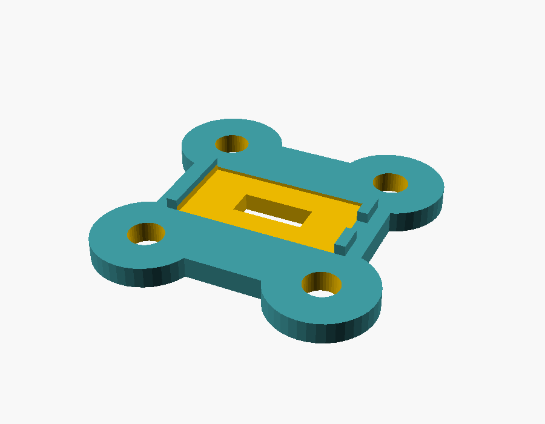 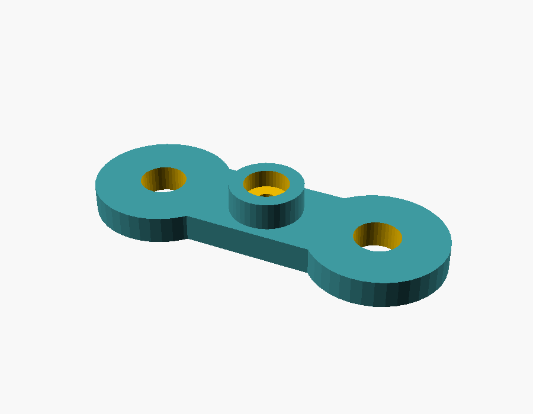

Modules are made in advance and reused. After a workshop, check each module. Two repairs come back regularly and can be done by a teacher or technician.

**Re-mounting the rotor** (rotor loose, turning on the shaft, or wobbling)

1. Connect the module to the station and put the servo in its **middle position** (set the fader and knob so the servo is in the middle of its range). Then switch the servo off by unplugging it, or by leaving the faders alone for a second.
2. Remove the screw and the rotor.
3. Put the rotor back on the shaft in the middle position, with the bar pointing the way you want the creature's neutral position to be.
4. Fasten the screw from the underside of the rotor. In the design, the screw head sits in the 5 mm recess on the underside, the screw passes through a 2 mm hole, and the shaft sits in the socket on top of the hub.
5. If the screw no longer grips (the thread in the shaft is worn), use a **slightly larger screw**.
6. Move the fader through its range and check that the rotor turns freely with the servo and nothing rubs on the plate.

**Re-gluing the base plate** (plate loose or came off the servo)

1. Remove old glue from the servo body and the plate.
2. Put the servo in the plate recess. Check that it sits flat, with the output shaft on the side where the rotor will be, and that the lead can leave the plate freely.
3. Apply **hot glue** around the servo body and the plate edge. Use little glue; stay clear of the output shaft and the rotor path.
4. Let it cool and harden completely, then pull and twist gently to test the joint.
5. Mount the rotor (see above) and test the servo on the station.

> **To confirm:** screw type and size (original and "larger"), glue type and the orientation of the servo in the plate are not recorded in the repository yet. Please add them, ideally with a photo of a finished module, to this section.

---

## 4. For technicians: construction, firmware, service and repair

### System overview

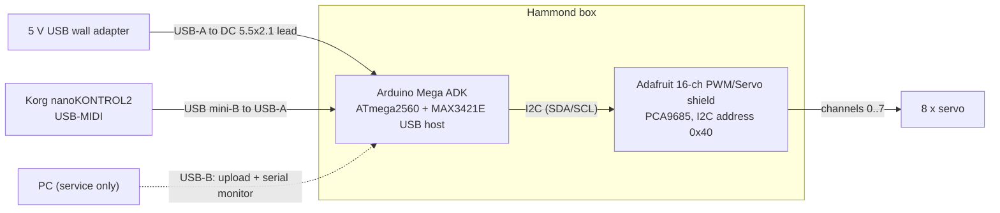

The nanoKONTROL2 is a USB-MIDI *device*. The Arduino Mega ADK has a built-in USB *host* (MAX3421E), so it can talk to the panel directly without a computer. The Arduino polls the panel, keeps the fader/knob/button state, and writes the servo positions to the PWM shield over I2C.

### 4.1 Part list (per station)

| Qty | Part | Picture | Link / notes |
|---:|---|:---:|---|
| 1 | **Arduino Mega ADK Rev3** (A000069) | 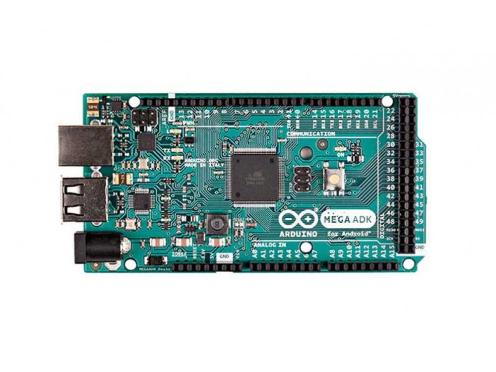 | [Digi-Key A000069](https://www.digikey.nl/nl/products/detail/arduino/A000069/2784003). **Discontinued** at many shops, see [sourcing notes](#sourcing-notes). |
| 1 | **Adafruit 16-channel 12-bit PWM/Servo Shield** (product 1411) | 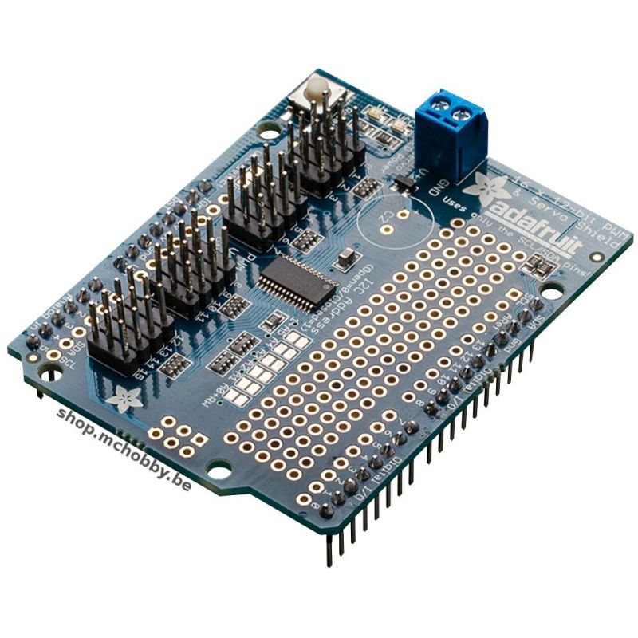 | [adafruit.com/product/1411](https://www.adafruit.com/product/1411) · also at [bitsandparts.nl](https://www.bitsandparts.nl/en/servo-pwm-shield-16-channel-12-bit-adafruit-1411-p1294469). Headers for channels 0–7 must be soldered in. |
| 1 | **Hammond 1593 enclosure for Arduino Mega** | 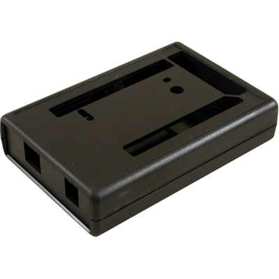 | [Hammond 1593HAM-ARD series](https://www.hammfg.com/electronics/small-case/development-board/1593ham-ard) (covers Mega ADK, e.g. 1593HAMAR3GY). The model in the photo (1593HAMMEGABK) is obsolete. |
| 1 | **Korg nanoKONTROL2** | 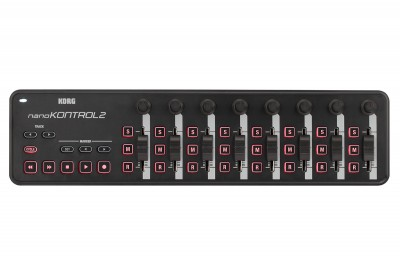 | [korg.com](https://www.korg.com/us/products/computergear/nanokontrol2/) · free **KORG KONTROL Editor** is needed once per panel (§4.3). |
| 8 | **Servo, analog micro**: HobbyKing HK15178 (1.4 kg·cm, 10 g, about 30 × 23 × 12 mm) | 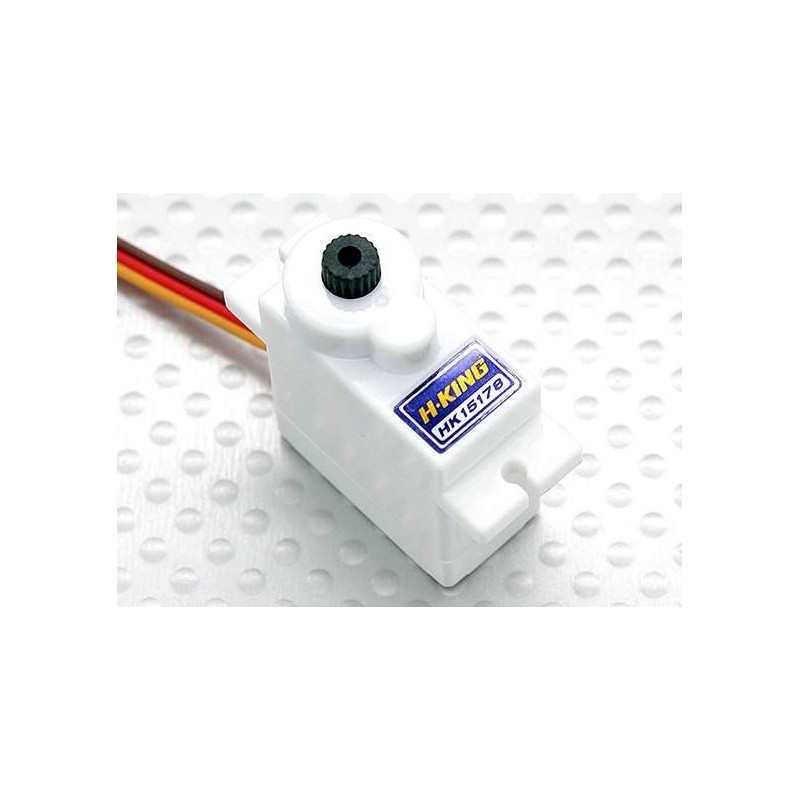 | [HobbyKing HK15178](https://hobbyking.com/en_us/hobbykingtm-hk15178-analog-servo-1-4kg-0-09sec-10g.html). **End of life**; keep spares, see [sourcing notes](#sourcing-notes). |
| 8 | **3D-printed small plate** |  | [`design/smallplate.stl`](design/smallplate.stl), see [§4.2](#42-3d-printed-parts). |
| as needed | **3D-printed small rotor** |  | [`design/smallrotor.stl`](design/smallrotor.stl). The larger plate and disc rotor in `design/` are not part of the standard kit. |
| 8 | **Servo extension lead**, 3-pin JR/Futaba, ~30 cm | 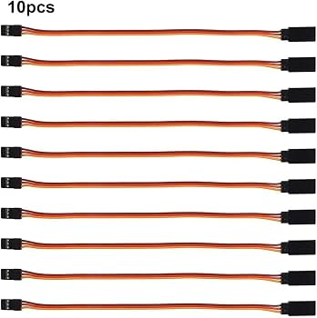 | [AZ-Delivery 10 × 32 cm](https://www.az-delivery.de/en/products/servo-verlangerungskabel-anschlusskabel-mannlich-zu-weiblich-jr-stecker-fur-rc-flugzeug) |
| 1 | **USB-A to mini-B cable**, ~1 m (panel to box) | 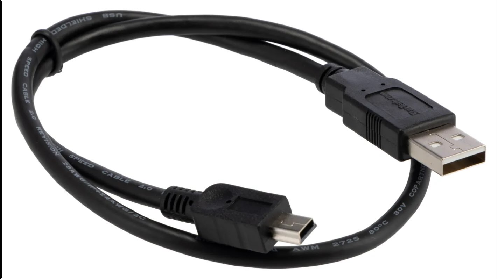 | e.g. [Digitus 1 m](https://www.itcurry.nl/nl/digitus-usb-2-0-connection-cable-type-a-mini-b-5pin-m-m-1m-usb-2-0-conform-black-db-300130-010-s/p/m9234457) |
| 1 | **USB-A to DC 5.5 × 2.1 mm power lead** | 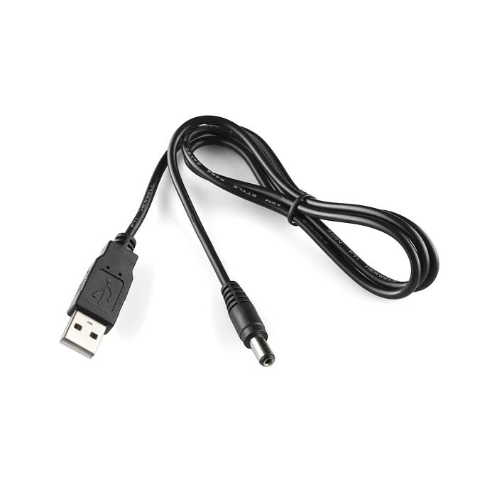 | [domoticx.net](https://domoticx.net/webshop/usb-a-5vdc-naar-dc-jack-55x21mm-recht-1-meter-kabel) |
| 1 | **USB wall adapter, 5 V, 2.1 A, EU plug** | 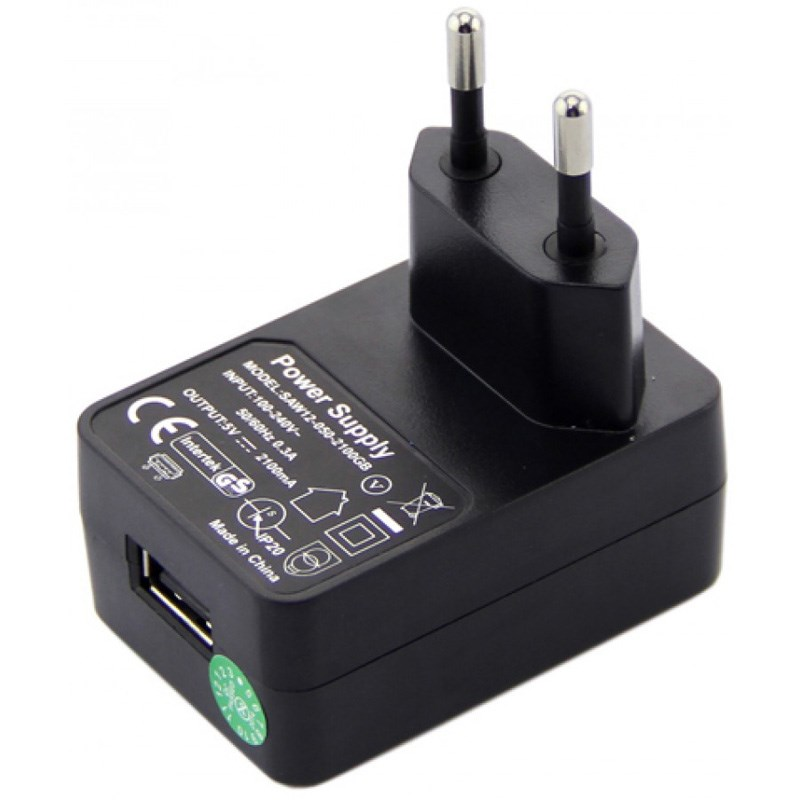 | The photographed one is a SAW12-050-2100GB. Equivalent: [Pro Elec PEL00394](https://es.farnell.com/pro-elec/pel00394/usb-power-supply-5v-2-1a-black/dp/4848894) |
| 1 | USB-A to USB-B cable (service only) | | Standard printer cable, for firmware upload and serial monitor. |
| ~100 | **Split pins** (brass paper fasteners) | | e.g. [nr. 6, 25 × 8.5 mm, 100 pcs](https://www.123inkt.nl/Kangaro-splitpennen-nr-6-25-x-8-5-mm-100-stuks-K-27006-i81071.html) |

Also for the workshop (not part of the station): cardboard, craft knife, hot-glue gun, green screen, camera, tablet with a chroma-key app.

#### Sourcing notes

- **Arduino Mega ADK** is discontinued. Stock is still around but unreliable. A Mega 2560 plus a separate *USB Host Shield 2.0* should run the same firmware in principle (use `board = megaatmega2560` and remove `-DBOARD_MEGA_ADK`), but that combination has **not been tested** here.
- **HK15178** servos are no longer made. If you switch to another micro servo (for example a 9 g type), check its outline against the recess (23 × 12 mm) and slot (10 × 4 mm) of the small plate (§4.2) before printing many plates, and re-check the pulse range (§4.5).

### 4.2 3D-printed parts

All four parts are in [`design/techcardadapter.scad`](design/techcardadapter.scad) (OpenSCAD). The file draws one part at a time: uncomment the call at the top (`plate();`, `smallplate();`, `rotor();` or `smallrotor();`). The STL files were exported from these modules. The pictures below are regenerated with [`design/render_images.sh`](design/render_images.sh) (needs OpenSCAD).

All round holes are **Ø 5 mm** (for split pins) unless stated otherwise. Base thickness is **3 mm** (`height = 3`).

| Part | STL | Size (mm) | Views |
|---|---|---|---|
| **Plate** (6 pin holes) | [`bottomplate.stl`](design/bottomplate.stl) = module `plate()` | 65 × 40 × 4.5 | 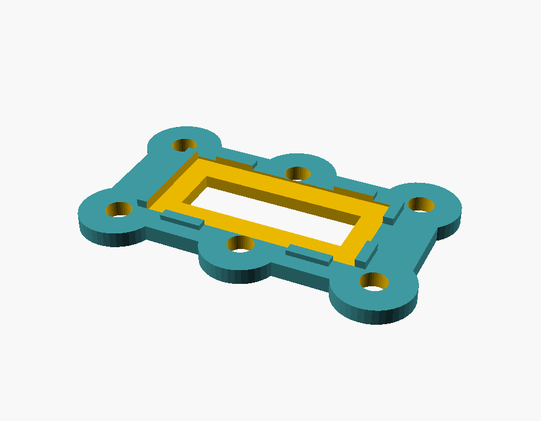 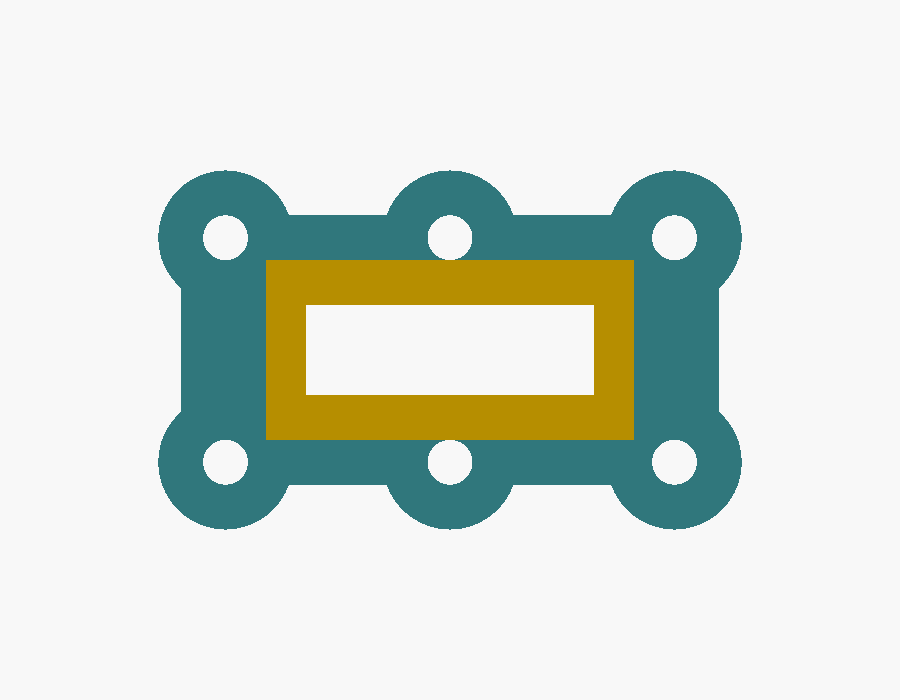 |
| **Small plate** (4 pin holes) | [`smallplate.stl`](design/smallplate.stl) = `smallplate()` | 40 × 40 × 4.5 |  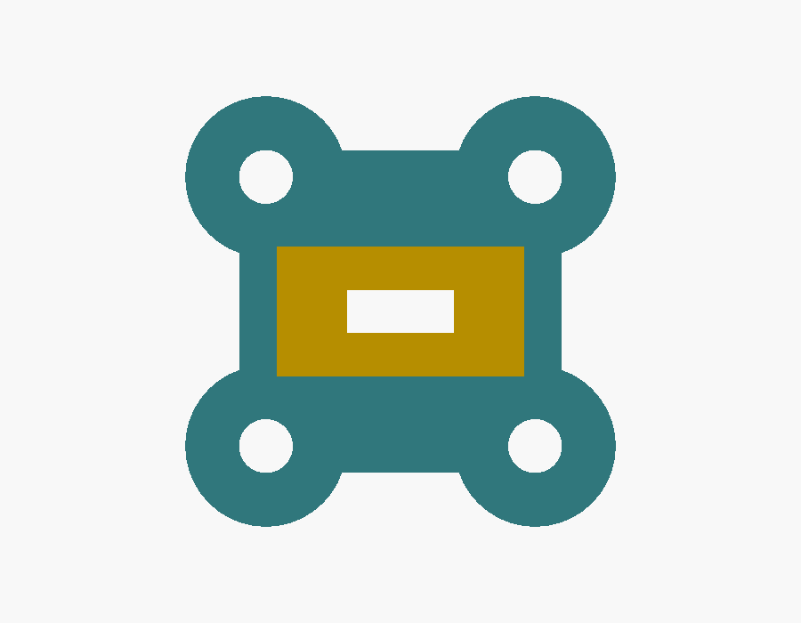 |
| **Rotor** (disc) | [`rotor.stl`](design/rotor.stl) = `rotor()` | Ø 50 × 7 | 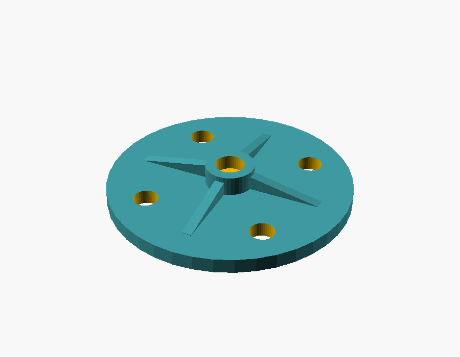 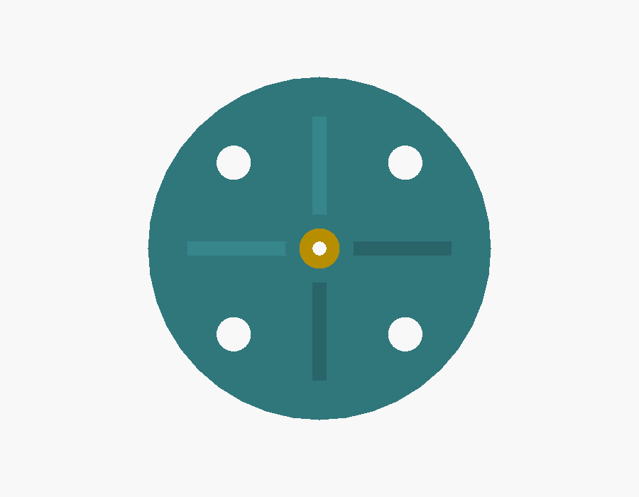 |
| **Small rotor** (bar) | [`smallrotor.stl`](design/smallrotor.stl) = `smallrotor()` | 40 × 15 × 6 |   |

(GitHub shows the STL files in an interactive 3D viewer when you click them.)

Dimensions taken from the SCAD file:

- **Plate:** six Ø 5 mm pin holes on a 25 mm pitch (x = −25, 0, 25; y = ±12.5). A **32 × 10 mm** slot goes through the plate. Around it is a **41 × 20 mm** recess (0.5 mm deep into the top), framed by small ribs (up to 1.5 mm above the plate) that locate the servo's mounting flange.
- **Small plate:** four Ø 5 mm pin holes on a 25 × 25 mm square, a smaller recess (23 × 12 mm) with ribs, and a 10 × 4 mm slot.
- **Rotor:** Ø 50 mm disc with four Ø 5 mm holes on the same 25 × 25 mm square as the small plate, a central hub (Ø 10, 4 mm above the disc) with a Ø 5.9 mm socket, a Ø 2 mm screw hole and four thin ribs on top.
- **Small rotor:** a bar with two Ø 5 mm pin holes 25 mm apart, a central hub (Ø 8, 3 mm above the bar) with a Ø 4.9 mm socket and a Ø 2 mm screw hole.

**Used in the standard kit:** the 40 × 40 mm **small plate** (`smallplate.stl`), glued to the servo, and the **small rotor** (`smallrotor.stl`), screwed on the output shaft instead of a horn (see [§3.7](#37-servo-modules-preparing-and-servicing)). The larger 65 × 40 mm plate (`bottomplate.stl`) and the disc rotor (`rotor.stl`) are kept in the repository as alternatives.

### 4.3 Assembly and wiring

#### Control box

1. Mount the Mega ADK in the Hammond box (the box comes with screws and the parts to hold the board).
2. Solder the 3 × 4 pin headers for **channels 0–7** on the Adafruit shield (the supplied headers are not fitted). Plug the shield onto the Mega. The shield only uses **SDA/SCL (I2C)**; I2C address **0x40** (default, no solder jumpers closed).
3. Close the box. Slots in the box give access to the USB-A host socket, the USB-B socket, the DC jack and the servo headers.

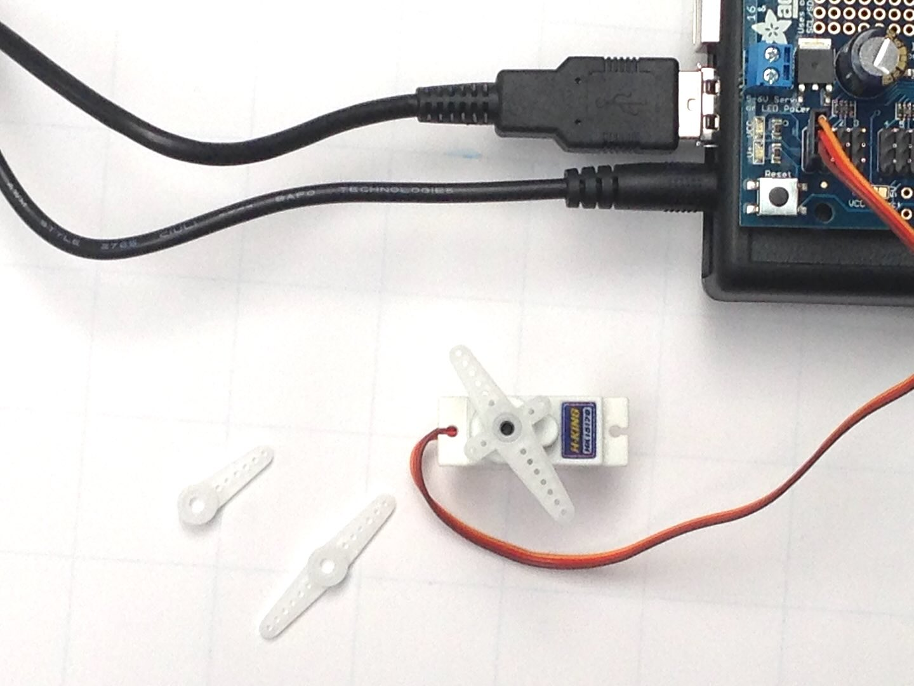

On the shield, each 3-pin header has three rows labelled **PWM**, **V+** and **GND**. The servo plug goes on with the signal wire (orange/yellow) on the PWM row, red on V+, brown/black on GND.

#### Firmware channel map

| Channel on shield | Servo | Fader / knob / R-M-S buttons |
|:---:|---|:---:|
| 0 … 7 | 1 … 8 | 1 … 8 (left to right) |
| 8 … 15 | not used | — |

#### Korg nanoKONTROL2 configuration (and resetting the LED mode)

The firmware lights the panel's buttons itself. It shows which channels are armed for recording (R), which are muted or solo, whether the station is recording (●) or playing (▶), and whether CYCLE is on. For that the panel must be set to **LED Mode = External**. If the panel is set to *Internal*, it lights buttons on its own and the lights no longer show what the station is doing.

**The panel sometimes falls back to the factory setting (LED mode *Internal*).** This is a regular technician task: when the buttons no longer light as expected, set it back as follows. It takes a few minutes and needs a computer.

**Tool:** the free **KORG KONTROL Editor** (Windows and macOS). Download it from the [nanoKONTROL2 page on korg.com](https://www.korg.com/us/products/computergear/nanokontrol2/) (button *Download KORG KONTROL Editor*). At the time of writing the current version is 2.5.1.

**Procedure**

1. Unplug the nanoKONTROL2 from the control box and connect it with its USB cable directly to the computer. (The editor cannot talk to the panel through the Arduino.)
2. Start the **KORG KONTROL Editor**. If asked, select **nanoKONTROL2** as the device.
3. Open the **CONTROL** tab and select **Common** at the top of the list on the left.
4. On the right, set:
   - **Global MIDI Channel = 1**
   - **Control Mode = CC**
   - **LED Mode = External**
5. Choose **Communication → Write Scene Data** in the menu and confirm. The settings only reach the panel at this point; the editor title may still say "Untitled".
6. Close the editor and unplug the panel from the computer.
7. Connect the panel to the control box again. Check: press an **R** button, it must light up and stay lit; press **●**, it must light while recording.

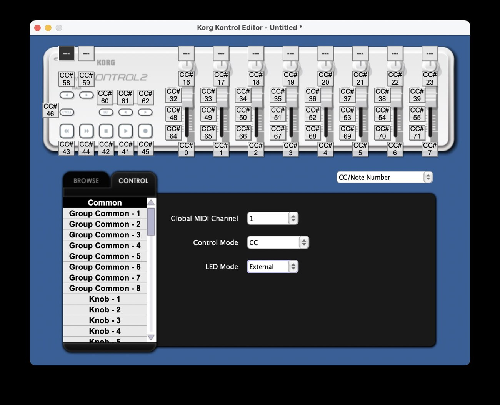

*The editor window with the correct settings. The small labels on the panel picture are the CC numbers; they are the factory numbers that the firmware expects (compare with the table in [§4.5](#45-how-the-firmware-works)). If some of them differ, the panel was changed or is not in CC mode.*

If the LEDs revert again after a while, simply repeat the procedure. Check this once as part of the pre-workshop test (§4.7).

#### Power

- Everything runs from one **5 V USB wall adapter**, connected with the USB-A to DC lead to the Arduino's **DC jack**.
- **Servo power:** a wire on the underside of the servo shield links the Arduino's **Vin** pin to the shield's **V+ input**. The blue screw terminal on the shield is therefore not used, and the servos get the same 5 V as the Arduino. The servo current flows through the Arduino's DC jack and Vin path.
- ⚠ **Never use an adapter with more than 5 V.** Because Vin is wired to V+, a 7–12 V adapter (what Arduino normally recommends for the DC jack) would put that voltage on the servos. The shield's servo rail is specified for up to 6 V.
- Powering the box only through the **USB-B socket** (for example while programming) does not feed Vin, so the servos get no power that way. That is fine for uploading firmware and reading the serial monitor; keep the servos unplugged or accept that they will not move.
- Arduino documents the DC jack input as 7–12 V; with less than 7 V the on-board regulator may deliver less than 5 V. The existing stations run this way. If you see random resets or the panel dropping out when many servos move, suspect the supply first: use the original 2.1 A adapter and a short, good-quality power lead.
- The nanoKONTROL2 takes less than 100 mA from the USB host socket.

### 4.4 Firmware (PlatformIO)

This is a [PlatformIO](https://platformio.org/) project for VS Code.

```text
platformio.ini      board = megaADK, libraries, build flags
src/main.cpp        the firmware (port of arduino/servoRecorder/servoRecorder.ino)
```

**Build and upload**

1. Install VS Code and the *PlatformIO IDE* extension.
2. Open this folder. PlatformIO downloads the toolchain and the libraries listed in `platformio.ini`:
   - [USB Host Shield Library 2.0](https://github.com/felis/USB_Host_Shield_2.0) (tag 1.7.0), which includes the `usbh_midi` class
   - [Adafruit PWM Servo Driver Library](https://github.com/adafruit/Adafruit-PWM-Servo-Driver-Library) (3.x) and [Adafruit BusIO](https://github.com/adafruit/Adafruit_BusIO)
3. Connect the USB-B socket of the Mega ADK to the computer. **Build** (✓) and **Upload** (→), or on the command line `pio run -t upload`.
4. **Serial monitor** (115200 baud): `pio device monitor`. It shows every MIDI message from the panel (`controller,value`) and the values sent to the servos.

**Build flags** (in `platformio.ini`)

| Flag | Meaning |
|---|---|
| `-DBOARD_MEGA_ADK` | Tells the USB host library that the MAX3421E is built into the board (set by default). |
| `-DXTOUCH` | Behringer X-Touch variant (step buttons react to any non-zero value). |
| `-DNO_SERVOSHIELD` | Drive 8 servos directly with `Servo.h` on pins 24–31 instead of the PWM shield. |

**Changes compared to the original Arduino IDE sketch**

- `#include <Arduino.h>` and function prototypes added (the Arduino IDE does this automatically, PlatformIO does not).
- Stray `;` after `#endif` removed.
- `MIDI Midi(&Usb);` became `USBH_MIDI Midi(&Usb);` because the library class has been renamed.
- `XTOUCH` and `SERVOSHIELD` can be set from `platformio.ini`.
- A message is printed on the serial port when the USB host fails to start.

Functionally the firmware behaves like the original.

**Build check:** the port was compiled and linked with avr-gcc against the Arduino AVR core 1.8.8 and the libraries above, for the default, `XTOUCH` and `NO_SERVOSHIELD` variants. Flash use was about 20 kB (7.8 %). Static RAM use was 7,325 of 8,192 bytes (89 %). It has not been run on hardware by the author of this port, so run it once on a station and check the serial monitor.

#### Alternative: compile and upload with the Arduino IDE (classic route)

You do not need PlatformIO. The same firmware is available as an Arduino IDE sketch in [`arduino/animationstation/animationstation.ino`](arduino/animationstation/animationstation.ino). It is a copy of `src/main.cpp` (which is the master; `tools/sync_sketch.sh` refreshes the copy after changes).

> **Do not use the old sketch** `arduino/servoRecorder/servoRecorder.ino` with the current libraries. It uses the old class name `MIDI`, which the current USB Host Shield library no longer has. The new sketch has that one change fixed.

1. Install the [Arduino IDE](https://www.arduino.cc/en/software) (2.x; 1.8.x also works).
2. Open the sketch: **File → Open…** and choose `arduino/animationstation/animationstation.ino`. Keep the sketch inside its folder (the folder name must match the file name).
3. Install the libraries: **Sketch → Include Library → Manage Libraries…** (or the library icon on the left in IDE 2.x). Search for and install:
   - **USB Host Shield Library 2.0** (authors Oleg Mazurov, Kristian Sloth Lauszus and others), version 1.7.0 or newer. It contains `usbh_midi`.
   - **Adafruit PWM Servo Driver Library** (3.0.x). When the IDE asks to install the dependencies too, choose **Install all**; this adds **Adafruit BusIO**. If you are not asked, search for *Adafruit BusIO* and install it yourself.
   - `Wire` and `SPI` are part of the IDE.
4. Select the board: **Tools → Board → Arduino AVR Boards → Arduino Mega ADK**. It has to be the *Mega ADK* entry (not "Arduino Mega or Mega 2560"), because that makes the USB host library use the ADK's built-in USB chip pins.
5. Connect the **USB-B** socket of the Mega ADK to the computer and choose the port under **Tools → Port**. (On Linux your user may need to be in the `dialout` group.)
6. Click **Verify** (✓) to compile, then **Upload** (→).
7. Open the **Serial Monitor** (**Tools → Serial Monitor**), set **115200 baud**. You should see the MIDI numbers when you move a fader.

The IDE cannot take build flags. To use the options from `platformio.ini`, edit the top of the sketch instead: remove the `//` in front of `//#define XTOUCH`, or add the line `#define NO_SERVOSHIELD` above `#ifndef NO_SERVOSHIELD`.

*Checked:* the sketch compiles and links for the Mega ADK board with the Arduino AVR core 1.8.8 and the libraries above, without any extra flags (same size as the PlatformIO build). It has not been tried in the IDE itself. Remember that powering the box only through USB-B gives the servos no power (§4.3, *Power*).

### 4.5 How the firmware works

**Loop.** Every 50 ms (`LOOPDELAY`, 20 Hz) the firmware looks at the current mode and, if needed, writes the servos. The USB stack and the panel are polled continuously in between.

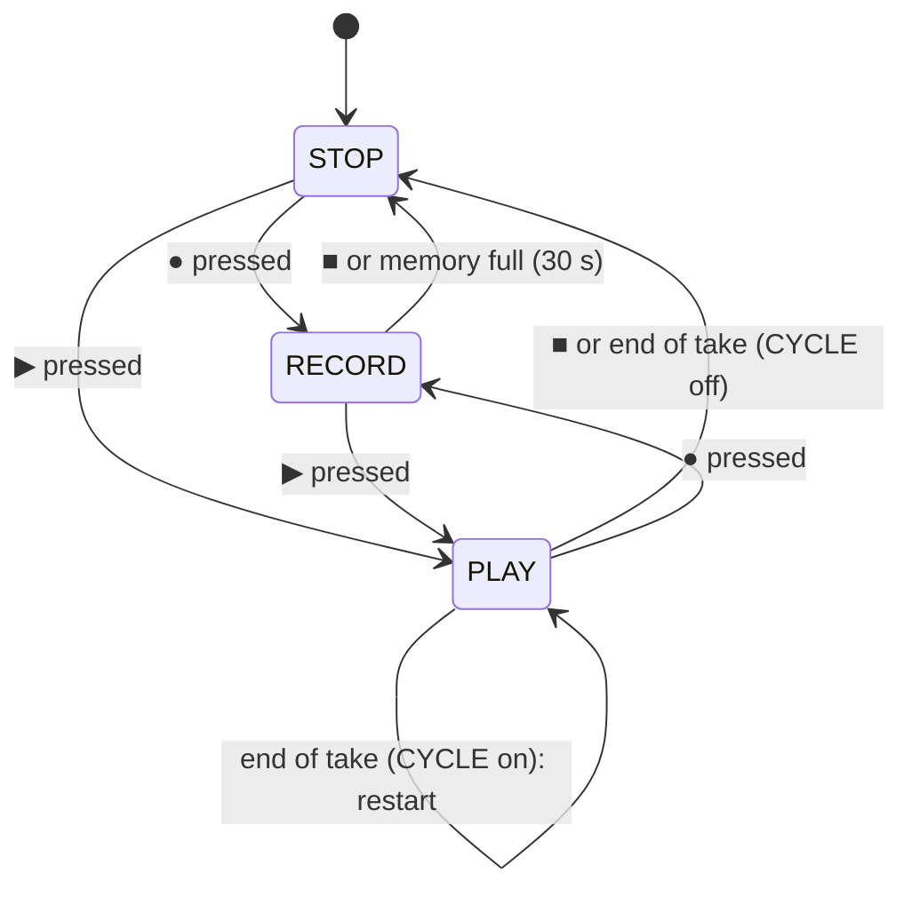

**Memory.** One recording is held in a RAM array of 600 steps (`MAX_STEPS`). Each step is 10 bytes: a 16-bit time stamp (in 50 ms units) and 8 servo values (0–127). That is 6,000 bytes of the Mega's 8 KB, so there is room for only about 80 more steps before the stack is at risk. For longer takes lower the sampling rate (raise `LOOPDELAY`) instead.

**Servo position.** For every servo: `value = fader − knob` (range −127 … 127), mapped to a PWM count between `SERVOMIN` (150) and `SERVOMAX` (480) out of 4096 at 50 Hz. With the Adafruit library's prescaler this gives a tick of about 4.88 µs, so the nominal pulse is about **0.73 ms … 2.34 ms** (mid 1.54 ms). Actual values depend on the PCA9685's internal oscillator.

Because the fader range is 0…127 and the knob is subtracted, **a fader covers only half of the full pulse range, and the knob selects which half**:

| Knob | Fader sweeps counts | Nominal pulse |
|---|---|---|
| fully left (0) | 315 … 480 | 1.54 … 2.34 ms |
| centre (64) | 231 … 396 | 1.13 … 1.93 ms |
| fully right (127) | 150 … 315 | 0.73 … 1.54 ms |

To change the travel adapt `SERVOMIN` / `SERVOMAX` (calibrate on one servo with the serial monitor open). Writing the value 0 to a channel switches its output off, which is how servos are made limp.

**Idle timeout.** In STOP mode, when nothing has changed for more than `TIMEOUT` loops (10 × 50 ms), `stop()` is called, which switches all outputs off. `stop()` is also called at the end of a take (CYCLE off).

**Record.** All steps are written with a time stamp. Only servos with **R** armed are written. When 5 s of memory are left the ● LED blinks; at the end of memory recording stops by itself.

**Play.** The next step is output when its time stamp has passed. The end of a take is detected by a step with time stamp 0 (see §4.6).

**Panel control numbers** (nanoKONTROL2 factory CC mode, channel 1):

| Control | CC number |
|---|---|
| Faders 1–8 | 0–7 |
| Knobs 1–8 | 16–23 |
| S (solo) 1–8 | 32–39 |
| M (mute) 1–8 | 48–55 |
| R (record arm) 1–8 | 64–71 |
| ▶ play | 41 |
| ■ stop | 42 |
| ◄◄ step back | 43 |
| ►► step forward | 44 |
| ● record | 45 |
| CYCLE | 46 |
| TRACK ◄ / ► | 58 / 59 (counted in the `page` variable, otherwise unused) |

The firmware sends the same CC numbers back to the panel with value 127 or 0 to light or dim the buttons.

**Serial debug output** (115200 baud): `controller,value` for every MIDI message received; during record/play/step one line per frame with the step number, the time stamp and the 8 servo values (`-` for muted servos).

**Setting up for other controllers.** The older variants (APC mini, APC mini on DUE and Teensy, MIDIMIX, Braccio) are not part of this port. They are kept in the original repository folder `arduino/servoRecorder/other versions/`.

### 4.6 Known limitations of the current firmware

These come from reading the code. They are left as in the original so that the port behaves the same; they are good candidates for the next version.

1. **Shorter re-recording keeps the old tail.** The end of a take is detected by a time stamp of 0 in the next step. After recording, no end marker is written, so if a new take is shorter than the old one the old steps continue to play. Fix idea: write `set[memoryCounter].time = 0` when recording stops.
2. **Unarmed servos keep old data.** Servos with R off are not written during recording; on playback they get whatever is in memory (0 after power-up).
3. **Fader and knob positions are unknown at power-up.** The panel does not report them; all values start at 0 until moved. Fix idea: ask the panel for its state or ignore servos not yet touched.
4. **Buffer over-read.** Step forward (►►) and the end-of-take test can read one step past the array (`set[MAX_STEPS]`).
5. **Solo only applies to playback and stepping**, not to live control.
6. **`page` / TRACK buttons** do nothing.
7. **`(int)(millis() - starttime)` in record** overflows after about 32.7 s. This is harmless as long as `MAX_STEPS × LOOPDELAY` stays below that. Keep this in mind when you lengthen the take.
8. `pinMode(7, OUTPUT); digitalWrite(7, HIGH);` is an old workaround for non-ADK USB host shields. The Mega ADK's MAX3421E reset is on an internal pin handled by the library, so this line is harmless but unnecessary.

### 4.7 Service and repair

**Before every workshop (5 minutes)**

- Power up, check the panel responds, and that the lights work: press an R button and ● and see them light (if not, reset the LED mode, §4.3).
- Wiggle all faders and knobs, then test all 8 servo channels with a spare servo.
- Check leads, plugs, rotor screws and glued base plates on every servo module; repair or replace damaged ones (§3.7).
- Check the box and the panel are clean and there are no loose split pins.

**Common repairs**

| Problem | Repair |
|---|---|
| Servo dead or gears stripped | Replace the servo module (keep spares, §4.1). Build a new one with glue and rotor as in §3.7, with the servo in its middle position. |
| Rotor loose or wobbling | Re-mount the rotor, with a larger screw if needed (§3.7). |
| Base plate loose | Re-glue with hot glue (§3.7). |
| Cracked printed plate | Reprint from the STL (3 mm thickness, ribs only 1–1.5 mm high). |
| Broken servo lead | Replace the extension lead. |
| Panel buttons do not light, or lights do not match what the station does | Panel has returned to LED mode *Internal*. Set it to *External* again with the KORG KONTROL Editor (§4.3), and do not forget *Communication → Write Scene Data*. |
| Panel not recognised | Try another USB cable. Check serial output for `USB host (MAX3421E) init failed`. Reflash firmware. |
| Firmware lost or corrupted | Re-upload from PlatformIO (§4.4). |
| Random resets | Check the 5 V adapter and lead (§4.3, *Power*). Do not swap in a higher-voltage adapter. |

**Replacing the Arduino or the shield:** upload the firmware, re-plug the shield, check the servo channel order against §4.3.

### 4.8 Repository layout

```text
README.md                this manual (English)
README.nl.md             Dutch version of this manual
platformio.ini           PlatformIO project (Arduino Mega ADK)
src/main.cpp             firmware
design/                  OpenSCAD source, STL files, rendered pictures, render script
docs/images/             photographs (system, servo connection, parts)
docs/quickcard-nl/       original Dutch quick card (PDF, Word, ePub)
arduino/animationstation/  Arduino IDE sketch (copy of src/main.cpp)
arduino/servoRecorder/   original Arduino IDE sketch and variants for other panels (old library names)
tools/sync_sketch.sh     copies src/main.cpp to the Arduino IDE sketch
```

### Credits and licences

- Firmware based on the *USB-MIDI to Legacy Serial MIDI converter* example by Yuuichi Akagawa (idea from the LPK25 converter by Collin Cunningham) and the Adafruit PWM Servo Driver example by Limor Fried / Ladyada.
- Libraries: [USB Host Shield 2.0](https://github.com/felis/USB_Host_Shield_2.0) (GPL-2.0), [Adafruit PWM Servo Driver](https://github.com/adafruit/Adafruit-PWM-Servo-Driver-Library) and [Adafruit BusIO](https://github.com/adafruit/Adafruit_BusIO) (BSD).
- **Licence of this repository: not yet chosen.** Note that the USB Host Shield library is GPL, which applies when you distribute compiled firmware.
