# Animation Station

🇬🇧 [English version](README.md)

Een klein werkstation om kartonnen wezens te laten bewegen met servomotoren.
Acht schuifknoppen (faders) op een Korg nanoKONTROL2 bewegen acht servo's live. De bewegingen kunnen **opgenomen** en **afgespeeld** worden, zodat een kind een wezen kan laten optreden en het daarna kan filmen voor een green screen.

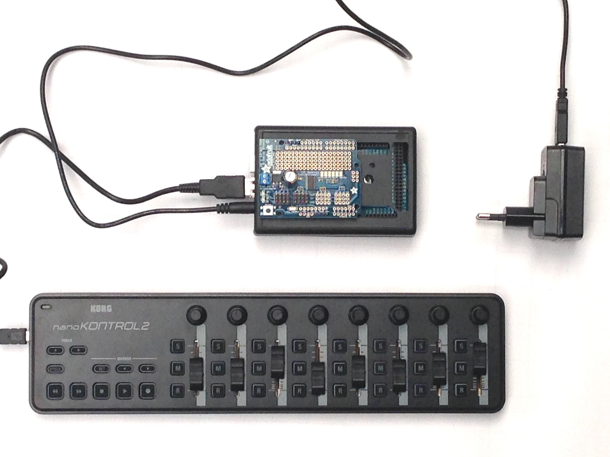

**Inhoud**

1. [Het idee van de workshop](#1-het-idee-van-de-workshop)
2. [Voor kinderen: zo laat je je wezen bewegen](#2-voor-kinderen-zo-laat-je-je-wezen-bewegen)
3. [Voor docenten: opstellen, bedienen en storingen zoeken](#3-voor-docenten-opstellen-bedienen-en-storingen-zoeken)
4. [Voor technici: bouw, firmware, onderhoud en reparatie](#4-voor-technici-bouw-firmware-onderhoud-en-reparatie)
   - [Onderdelenlijst](#41-onderdelenlijst-per-station) · [3D-geprinte onderdelen](#42-3d-geprinte-onderdelen) · [Montage en bedrading](#43-montage-en-bedrading) · [Firmware](#44-firmware-platformio) · [Hoe de firmware werkt](#45-hoe-de-firmware-werkt) · [Bekende beperkingen](#46-bekende-beperkingen-van-de-huidige-firmware) · [Onderhoud en reparatie](#47-onderhoud-en-reparatie) · [Indeling van de repository](#48-indeling-van-de-repository)

---

## 1. Het idee van de workshop

1. Kinderen bouwen een **kartonnen wezen**.
2. Ze bevestigen kant-en-klare **servomodules** erin met **splitpennen** (een servomodule is een servo met een 3D-geprinte basisplaat en rotor, vooraf klaargemaakt, zie [§3.7](#37-servomodules-voorbereiden-en-onderhouden)).
3. Het wezen komt voor een **green screen** en een camera.
4. Het kind speelt de bewegingen met de schuifknoppen, **neemt ze op** en **speelt ze af** terwijl de camera draait.
5. Daarna wordt het groen vervangen door een passende achtergrond met een chroma-key-app op een tablet.
6. Aan het eind worden de servo's uit het wezen gehaald. Kinderen nemen **hun wezen en hun film** mee naar huis; het animatiestation en de servo's blijven.

Elk station bestuurt **8 servo's**.

---

## 2. Voor kinderen: zo laat je je wezen bewegen

> **Veiligheid eerst**
> Stanleymessen zijn scherp en lijmpistolen zijn heet. 

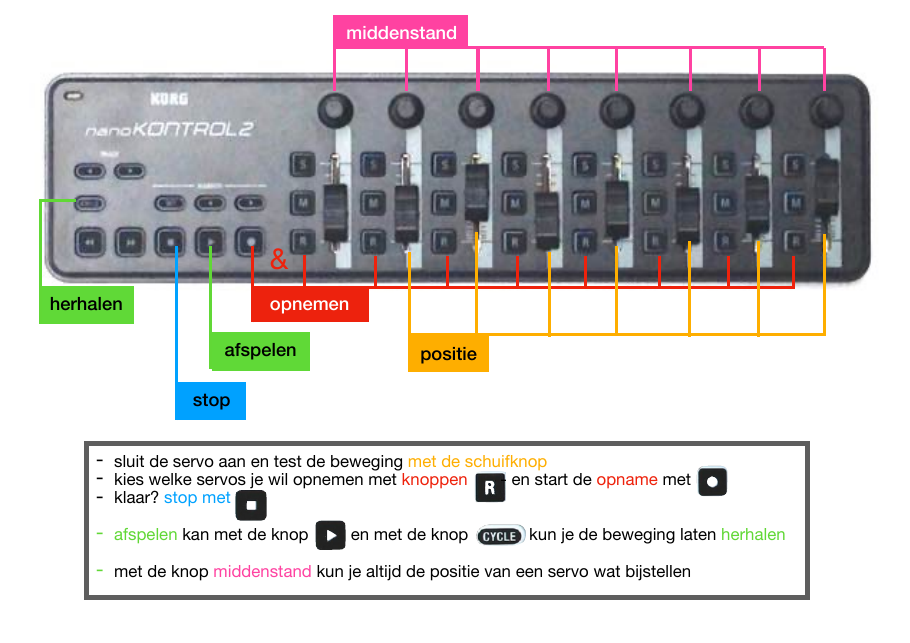

*De instructiekaart voor op tafel. De originele bestanden (PDF, Word, ePub) staan in [`docs/quickcard-nl/`](docs/quickcard-nl/).*

### Een servo aansluiten

Een servo heeft een stekker met drie draadjes. Steek hem in het blauwe besturingskastje **kleur op kleur**: de **oranje** (of gele) draad in de bovenste rij, **rood** in het midden, **bruin/zwart** in de onderste rij.
Servostekker 0 wordt bewogen door **schuifknop 1** (de meest linkse), stekker 1 door schuifknop 2, enzovoort tot en met stekker 7 en schuifknop 8.

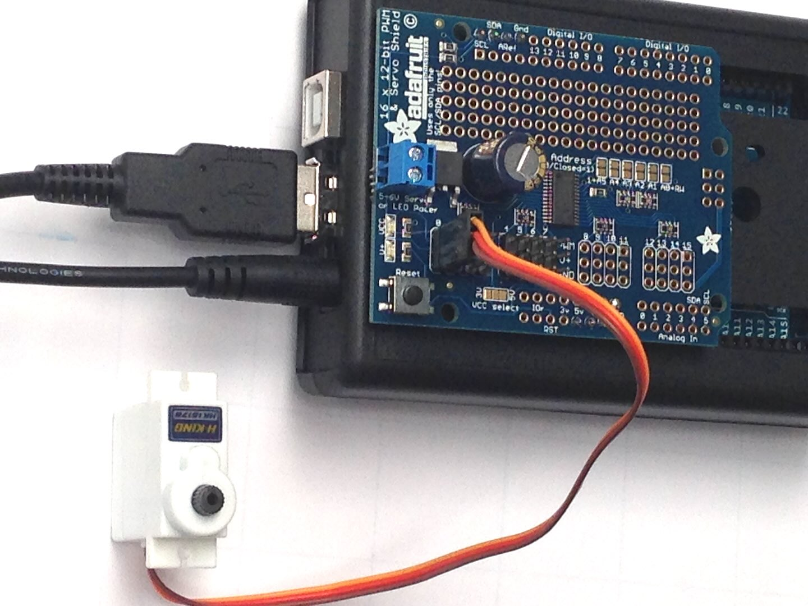

### Laat hem bewegen

| Ik wil… | Dan doe ik dit |
|---|---|
| **Een servo bewegen** | Duw of trek aan zijn **schuifknop**. |
| **De middenstand instellen** | Draai aan de **draaiknop** boven de schuifknop. Handig om een arm precies de goede kant op te laten wijzen. |
| **Kiezen wat er wordt opgenomen** | Druk op de **R**-knop onder de schuifknop van elke servo die je wilt opnemen. Hij gaat branden. |
| **Opnemen** | Druk op **●** (de ronde knop). Beweeg de schuifknoppen. Je hebt **30 seconden**. |
| **Stoppen** | Druk op **■**. |
| **Afspelen** | Druk op **▶**. Je bewegingen worden afgespeeld. |
| **Steeds opnieuw afspelen** | Druk op **CYCLE** (herhalen) voor of tijdens het afspelen. Druk nog een keer om uit te zetten. |
| **Eén servo stil zetten** | Druk op **M** (mute) onder zijn schuifknop. |
| **Alleen één servo afspelen** | Druk op **S** (solo). Druk nog een keer om weer alles te zien bewegen. |
| **Stap voor stap door de opname** | **◄◄** en **►►**. |

### Goed om te weten

- **Beweeg alle schuifknoppen en draaiknoppen één keer heen en weer** voordat je begint. Het kastje weet pas waar een schuifknop staat als je hem beweegt.
- Servo's worden **slap** kort nadat je de schuifknoppen loslaat. Dat is normaal. Je kunt het onderdeel dan voorzichtig met de hand verdraaien.
- De **R**-knop moet branden bij elke servo die je wilt opnemen.
- Het station onthoudt **één opname**. Een nieuwe opname vervangt de oude. Maak je film **voordat** het station wordt uitgezet.
- Als het opnamelampje gaat **knipperen**, heb je nog 5 seconden.
- Kleine bewegingen zien er vaak beter uit dan grote.
- Werkt er iets niet? Trek niet aan draden. **Vraag het een docent.**

---

## 3. Voor docenten: opstellen, bedienen en storingen zoeken

### 3.1 Wat u op tafel nodig heeft

| Onderdeel | Opmerkingen |
|---|---|
| Besturingskastje (Arduino Mega ADK + servoshield in een zwarte Hammond-behuizing) | met voedingskabel |
| Korg nanoKONTROL2 | met een USB-kabel op het kastje aangesloten |
| USB-voeding (5 V) | voedt het kastje |
| 8 servo draadjes | al verbonden met de servoshield |
| 8 **servomodules** (servo + vastgelijmde basisplaat + aangeschroefde rotor), elk met een servoverlengkabel | vooraf klaargemaakt, zie §3.7 |
| Splitpennen | om de modules en bewegende delen in het karton te bevestigen |
| Reservemodules, kleine schroevendraaier, reserveschroeven, lijmpistool | voor snelle reparaties (§3.7) |
| Camera + green screen + tablet met chroma-key-app | voor de film |

### 3.2 Opstellen

1. Zet de nanoKONTROL2 en het besturingskastje naast elkaar.
2. Sluit de nanoKONTROL2 aan op de **USB-A-aansluiting** van het kastje (de rechthoekige USB-poort, niet de vierkante USB-B).
3. Steek de USB-naar-DC-kabel van de voeding in de ronde **voedingsaansluiting** van het kastje en steek de voeding in het stopcontact.
4. Steek de servo's in kanaal **0 tot en met 7** van het servoshield, kleur op kleur (signaal/oranje boven, rood in het midden, bruin/zwart onder). Servo 0 hoort bij schuifknop 1. Een servo kan direct of via een langer (verleng) snoertje verbonden worden. Kijk goed op plaatjes welke kant bruin en welke kant oranje is!
5. Beweeg elke schuifknop en draaiknop één keer over het hele bereik.
6. Test elke servo met zijn schuifknop **voordat** hij in een wezen komt.

> **Monteer servomodules met de servo in de middenstand.** Zet de servo, voordat de rotor wordt vastgeschroefd (§3.7), in het midden van zijn bereik, zodat het wezen beide kanten op kan bewegen. Als dit niet gedaan is kan het zijn dat een kind de servo er eerst uit moet halen, middenstand moet zoeken en weer terug moet bouwen. 

### 3.3 De bediening in detail

| Bediening | Functie |
|---|---|
| Schuifknoppen 1–8 | Positie van servo 1–8 |
| Draaiknoppen 1–8 | Offset ("middenstand") per servo. Altijd actief, ook tijdens afspelen. De opname bewaart de ruwe bewegingen van de schuifknop; de draaiknop wordt opgeteld wanneer de servo wordt aangestuurd. |
| **R** (opname-arm) | De servo wordt opgenomen als de knop brandt. |
| **M** (mute) | De servo krijgt niets, niet live en niet bij afspelen (brandt als gedempt). |
| **S** (solo) | Bij afspelen en stappen wordt alleen deze servo aangestuurd (brandt). Druk nog eens om solo te verlaten. |
| **●** | Opname starten. Maximaal 30 s; de opname stopt vanzelf als het geheugen vol is. |
| **▶** | Afspelen vanaf het begin. |
| **■** | Stop. |
| **CYCLE** | Herhalen (brandt als het aan staat). |
| **◄◄ / ►►** | Stoppen en één stap (50 ms) terug / vooruit. |
| TRACK ◄ ►, MARKER, SET | Niet in gebruik. |

Gedrag van de lampjes: ● brandt tijdens opnemen en knippert de laatste 5 seconden; ▶ brandt tijdens afspelen; CYCLE brandt als herhalen aan staat.

### 3.4 Een gewone sessie

1. Bevestig de servomodules in het wezen: de basisplaat gaat met splitpennen door de vier hoekgaten op het karton, en het bewegende deel van het wezen wordt met splitpennen aan de rotor bevestigd.
2. Aansluiten, schuifknoppen heen en weer bewegen, de beweging testen.
3. Druk op **R** bij elke servo die opgenomen moet worden, druk op **●**, speel, druk op **■**.
4. Druk op **▶** om te controleren. Niet goed? Neem opnieuw op. Gebruik **CYCLE** om het te herhalen tijdens het filmen.
5. Film het wezen voor de green screen terwijl de opname wordt afgespeeld.
6. Na de workshop: open de splitpennen, haal de servomodules eruit en leg ze terug in de kist. Controleer ze op schade (§3.7).

### 3.5 Dingen die mensen verrassen

- **Slechts één opname.** Die zit in het geheugen van de Arduino. Hij gaat verloren als de stroom wordt weggehaald of de resetknop wordt ingedrukt. Een nieuwe opname overschrijft de oude.
- **Servo's ontspannen.** In stopstand worden, ongeveer een halve seconde nadat de laatste schuifknop is bewogen, alle servo-uitgangen uitgeschakeld, en ook als een opname klaar is met afspelen worden ze uitgeschakeld. De servo's houden hun positie dan niet meer vast.
- **Na het aanzetten** kent het kastje de posities van de schuif- en draaiknoppen niet. Als u één schuifknop beweegt, springen servo's waarvan de schuifknop nog nooit is aangeraakt naar het einde van hun bereik. Beweeg eerst alle schuif- en draaiknoppen.
- **Kortere nieuwe opname:** als een nieuwe opname *korter* is dan de vorige, kan het einde van de oude opname erachter aan afspelen. Druk op de resetknop van de Arduino (of haal de stroom eraf en weer erop) en neem opnieuw op.
- **Servo's die tijdens het opnemen niet gewapend (R) waren** bewegen bij afspelen toch, naar een vaste positie. Wapen alle servo's die gebruikt worden en demp servo's die niet gebruikt worden.

### 3.6 Storingen zoeken

| Verschijnsel | Waarschijnlijke oorzaak | Wat te doen |
|---|---|---|
| Er brandt niets op de nanoKONTROL2 | Geen USB-voeding of verkeerde aansluiting | Controleer of de USB-kabel op de USB-A-hostaansluiting van de Arduino zit en of de Arduino stroom heeft. |
| Paneel is aan, maar er beweegt niets | Paneel niet herkend door de USB-host, of kastje niet gevoed | Haal de voeding eraf, wacht 5 s, steek hem er weer in. Controleer met de seriële monitor (§4.4). |
| Knoppen werken maar **er branden geen knopjes** | LED-modus van het paneel staat op "Internal" | Technicus: zet de LED Mode van het paneel terug op *External* met de Korg KONTROL Editor (§4.3, *LED-modus terugzetten*). Het paneel valt soms terug op de fabrieksinstelling. |
| Eén servo beweegt niet | Stekker verkeerd om of in het verkeerde kanaal, gedempt (M brandt), kapotte verlengkabel | Controleer kleur op kleur, controleer de M-knop, probeer een andere kabel. |
| Servo trilt of bromt | Karton blokkeert de beweging, of de voeding is zwak | Maak het mechaniek vrij; controleer voeding en kabels. |
| Alle servo's trekken of het kastje herstart als er veel tegelijk bewegen | Voeding te zwak, of kabel te lang/dun | Gebruik de originele 5 V / 2,1 A-voeding en een korte, goede voedingskabel. Gebruik nooit een voeding met een hogere spanning. Zie §4.3, *Voeding*. |
| Servo staat bij het starten in een rare stand | Schuif- of draaiknop nog niet bewogen | Beweeg alle schuif- en draaiknoppen één keer. |
| Afspelen heeft een extra staart | Kortere nieuwe opname (zie 3.5) | Reset de Arduino, neem opnieuw op. |
| Servo draait de verkeerde kant op | Mechanische montage | Spiegel het stangenstelsel in het wezen. |
| Servo bromt maar de rotor draait niet mee, of de rotor wiebelt | Rotorschroef los of schroefdraad versleten | Monteer de rotor opnieuw (§3.7). |
| Basisplaat zit los van de servo of is los | Hotmelt-lijm heeft losgelaten | Lijm de basisplaat opnieuw vast (§3.7). |

### 3.7 Servomodules: voorbereiden en onderhouden

Een **servomodule** is de kleine HobbyKing-servo, klaargemaakt voor de workshop:

- de **basisplaat** van 40 × 40 mm ([`smallplate.stl`](design/smallplate.stl)) is met **hotmelt-lijm** op het servohuis vastgelijmd. De kinderen bevestigen deze plaat met splitpennen aan het karton;
- er zit **geen servohoorn** op. In plaats daarvan is de geprinte **kleine rotor** ([`smallrotor.stl`](design/smallrotor.stl)) **rechtstreeks op de uitgaande as van de servo geschroefd**. Het bewegende deel van het wezen wordt aan de rotor bevestigd.

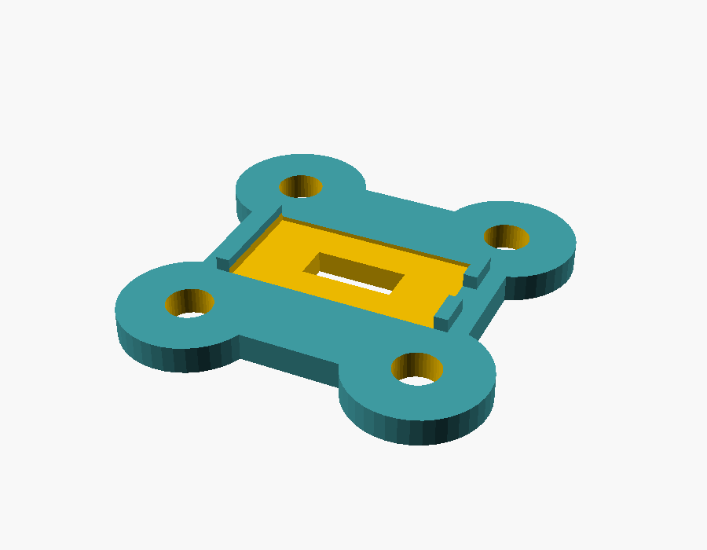 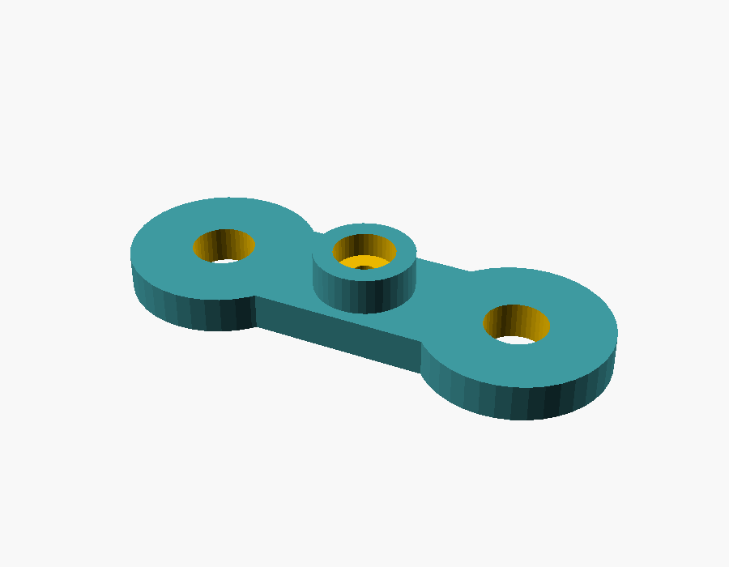

Modules worden vooraf gemaakt en hergebruikt. Controleer elke module na een workshop. Twee reparaties komen regelmatig voor en kunnen door een docent of technicus worden gedaan.

**De rotor opnieuw monteren** (rotor los, draait op de as, of wiebelt)

1. Sluit de module aan op het station en zet de servo in zijn **middenstand** (stel schuifknop en draaiknop zo in dat de servo in het midden van zijn bereik staat). Schakel de servo daarna uit door hem los te koppelen, of door een seconde van de schuifknoppen af te blijven.
2. Haal de schroef en de rotor eraf.
3. Zet de rotor in de middenstand terug op de as, met de balk gericht zoals de neutrale stand van het wezen moet zijn.
4. Draai de schroef vast vanaf de onderkant van de rotor. In het ontwerp zit de schroefkop in de verzonken uitsparing van 5 mm aan de onderkant, de schroef gaat door een gat van 2 mm, en de as zit in de opening bovenop de naaf.
5. Als de schroef niet meer vastzit (de schroefdraad in de as is versleten), gebruik dan een **iets grotere schroef**.
6. Beweeg de schuifknop over zijn bereik en controleer dat de rotor soepel met de servo meedraait en nergens tegen de plaat schuurt.

**De basisplaat opnieuw vastlijmen** (plaat los of van de servo af)

1. Verwijder oude lijm van het servohuis en van de plaat.
2. Leg de servo in de uitsparing van de plaat. Controleer dat hij vlak ligt, met de uitgaande as aan de kant waar de rotor komt, en dat het snoer vrij uit de plaat kan.
3. Breng **hotmelt-lijm** aan rond het servohuis en de rand van de plaat. Gebruik weinig lijm; blijf uit de buurt van de uitgaande as en het pad van de rotor.
4. Laat het helemaal afkoelen en uitharden, trek en draai daarna voorzichtig om de verbinding te testen.
5. Monteer de rotor (zie hierboven) en test de servo op het station.

> **Nog te bevestigen:** schroeftype en -maat (de originele en de "grotere"), lijmsoort en de stand van de servo in de plaat zijn nog niet in de repository vastgelegd. Voeg ze toe aan dit hoofdstuk, het liefst met een foto van een afgemaakte module.

---

## 4. Voor technici: bouw, firmware, onderhoud en reparatie

### Systeemoverzicht

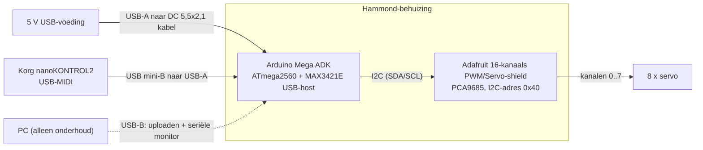

De nanoKONTROL2 is een USB-MIDI-*apparaat*. De Arduino Mega ADK heeft een ingebouwde USB-*host* (MAX3421E), dus hij kan rechtstreeks met het paneel praten zonder computer. De Arduino leest het paneel uit, houdt de toestand van schuifknoppen, draaiknoppen en knoppen bij, en schrijft de servoposities via I2C naar het PWM-shield.

### 4.1 Onderdelenlijst (per station)

| Aantal | Onderdeel | Foto | Link / opmerkingen |
|---:|---|:---:|---|
| 1 | **Arduino Mega ADK Rev3** (A000069) | 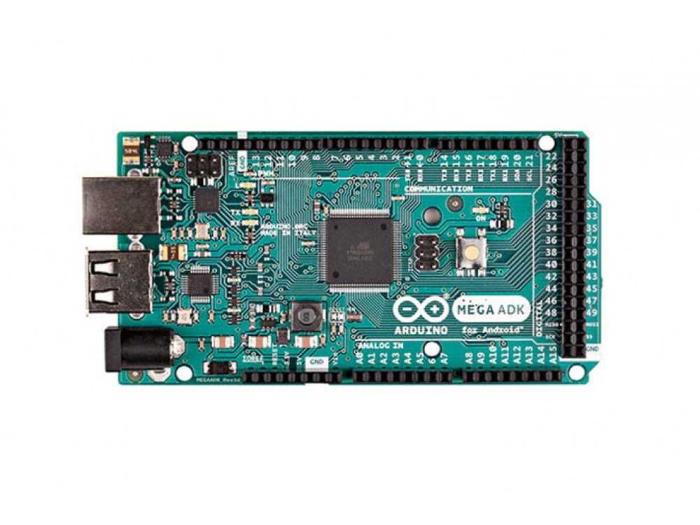 | [Digi-Key A000069](https://www.digikey.nl/nl/products/detail/arduino/A000069/2784003). Bij veel winkels **uit productie**, zie [inkoopnotities](#inkoopnotities). |
| 1 | **Adafruit 16-kanaals 12-bit PWM/Servo Shield** (product 1411) | 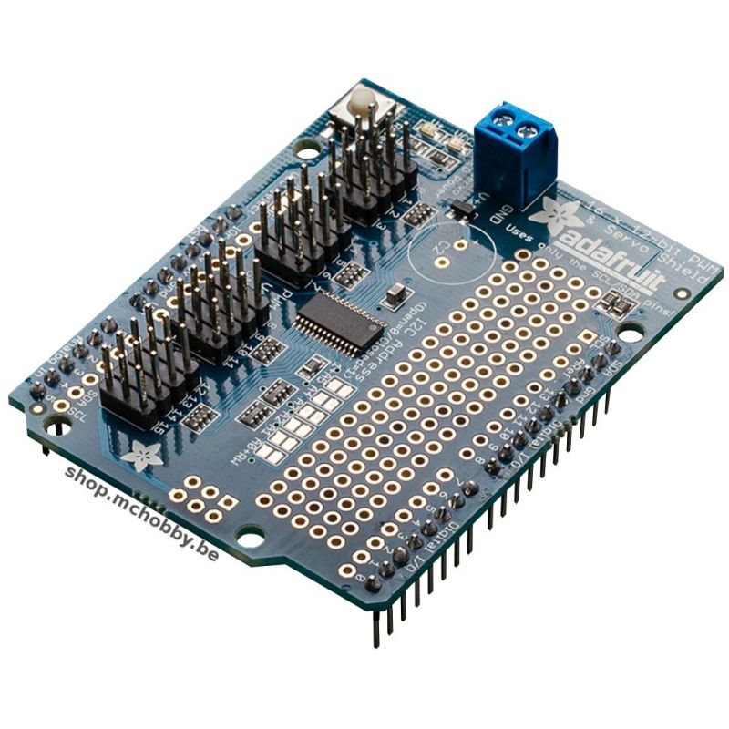 | [adafruit.com/product/1411](https://www.adafruit.com/product/1411) · ook bij [bitsandparts.nl](https://www.bitsandparts.nl/en/servo-pwm-shield-16-channel-12-bit-adafruit-1411-p1294469). De pinheaders voor kanaal 0–7 moeten worden ingesoldeerd. |
| 1 | **Hammond 1593-behuizing voor Arduino Mega** | 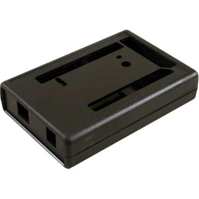 | [Hammond 1593HAM-ARD-serie](https://www.hammfg.com/electronics/small-case/development-board/1593ham-ard) (past op Mega ADK, bijv. 1593HAMAR3GY). Het model op de foto (1593HAMMEGABK) is niet meer leverbaar. |
| 1 | **Korg nanoKONTROL2** | 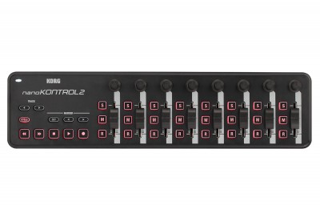 | [korg.com](https://www.korg.com/us/products/computergear/nanokontrol2/) · de gratis **KORG KONTROL Editor** is eenmalig per paneel nodig (§4.3). |
| 8 | **Servo, analoog micro**: HobbyKing HK15178 (1,4 kg·cm, 10 g, ca. 30 × 23 × 12 mm) | 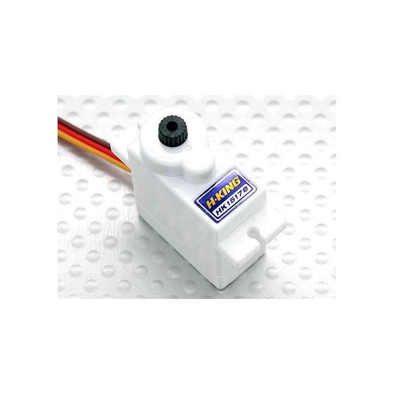 | [HobbyKing HK15178](https://hobbyking.com/en_us/hobbykingtm-hk15178-analog-servo-1-4kg-0-09sec-10g.html). **Einde levensduur**; bewaar reserves, zie [inkoopnotities](#inkoopnotities). |
| 8 | **3D-geprinte kleine plaat** |  | [`design/smallplate.stl`](design/smallplate.stl), zie [§4.2](#42-3d-geprinte-onderdelen). |
| naar behoefte | **3D-geprinte kleine rotor** |  | [`design/smallrotor.stl`](design/smallrotor.stl). De grotere plaat en de ronde rotor in `design/` horen niet bij de standaardset. |
| 8 | **Servoverlengkabel**, 3-polig JR/Futaba, ~30 cm | 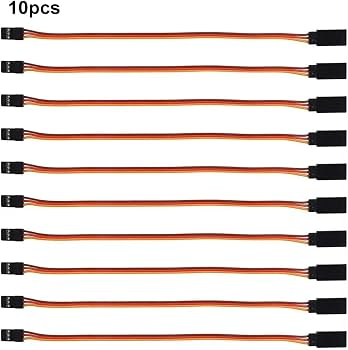 | [AZ-Delivery 10 × 32 cm](https://www.az-delivery.de/en/products/servo-verlangerungskabel-anschlusskabel-mannlich-zu-weiblich-jr-stecker-fur-rc-flugzeug) |
| 1 | **USB-A naar mini-B-kabel**, ~1 m (paneel naar kastje) | 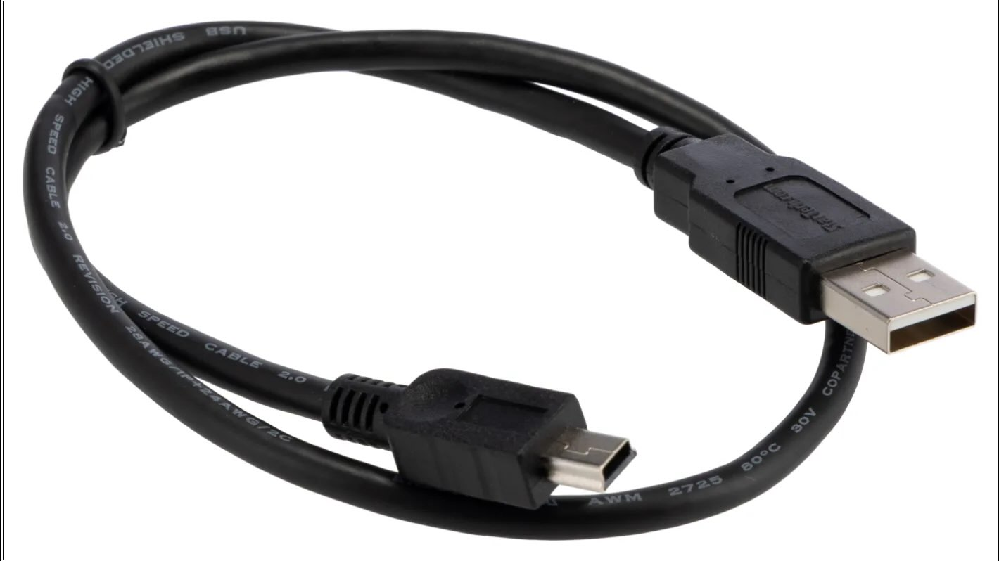 | bijv. [Digitus 1 m](https://www.itcurry.nl/nl/digitus-usb-2-0-connection-cable-type-a-mini-b-5pin-m-m-1m-usb-2-0-conform-black-db-300130-010-s/p/m9234457) |
| 1 | **USB-A naar DC 5,5 × 2,1 mm voedingskabel** | 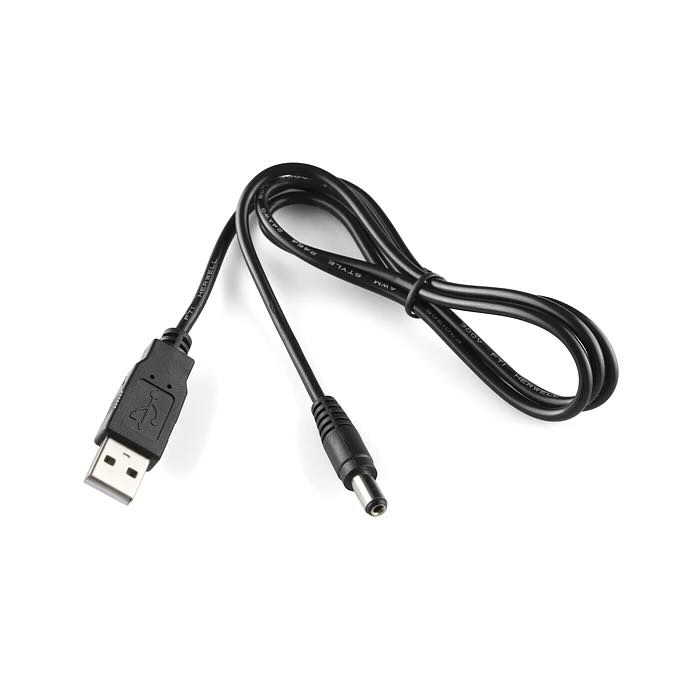 | [domoticx.net](https://domoticx.net/webshop/usb-a-5vdc-naar-dc-jack-55x21mm-recht-1-meter-kabel) |
| 1 | **USB-voeding, 5 V, 2,1 A, EU-stekker** | 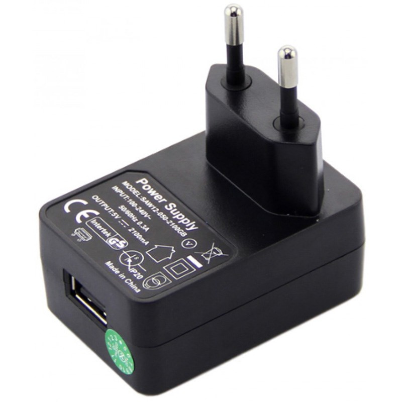 | Die op de foto is een SAW12-050-2100GB. Gelijkwaardig: [Pro Elec PEL00394](https://es.farnell.com/pro-elec/pel00394/usb-power-supply-5v-2-1a-black/dp/4848894) |
| 1 | USB-A naar USB-B-kabel (alleen onderhoud) | | Gewone printerkabel, voor firmware uploaden en de seriële monitor. |
| ~100 | **Splitpennen** (messing bindpennen) | | bijv. [nr. 6, 25 × 8,5 mm, 100 stuks](https://www.123inkt.nl/Kangaro-splitpennen-nr-6-25-x-8-5-mm-100-stuks-K-27006-i81071.html) |

Ook nodig voor de workshop (niet bij het station): karton, stanleymes, lijmpistool, green screen, camera, tablet met chroma-key-app.

#### Inkoopnotities

- De **Arduino Mega ADK** is niet meer in productie. Er is nog voorraad, maar die is onbetrouwbaar. Een Mega 2560 met een losse *USB Host Shield 2.0* zou in principe dezelfde firmware moeten draaien (gebruik `board = megaatmega2560` en verwijder `-DBOARD_MEGA_ADK`), maar die combinatie is hier **niet getest**.
- **HK15178**-servo's worden niet meer gemaakt. Als u overstapt op een andere microservo (bijvoorbeeld een 9 g-type), controleer dan de afmetingen tegen de uitsparing (23 × 12 mm) en de sleuf (10 × 4 mm) van de kleine plaat (§4.2) voordat u veel platen print, en controleer het pulsbereik opnieuw (§4.5).

### 4.2 3D-geprinte onderdelen

Alle vier de onderdelen zitten in [`design/techcardadapter.scad`](design/techcardadapter.scad) (OpenSCAD). Het bestand tekent steeds één onderdeel: haal bovenin de aanroep uit commentaar (`plate();`, `smallplate();`, `rotor();` of `smallrotor();`). De STL-bestanden zijn uit deze modules geëxporteerd. De afbeeldingen hieronder worden opnieuw gemaakt met [`design/render_images.sh`](design/render_images.sh) (OpenSCAD nodig).

Alle ronde gaten zijn **Ø 5 mm** (voor splitpennen), tenzij anders vermeld. De basisdikte is **3 mm** (`height = 3`).

| Onderdeel | STL | Afmetingen (mm) | Aanzichten |
|---|---|---|---|
| **Plaat** (6 pengaten) | [`bottomplate.stl`](design/bottomplate.stl) = module `plate()` | 65 × 40 × 4,5 | 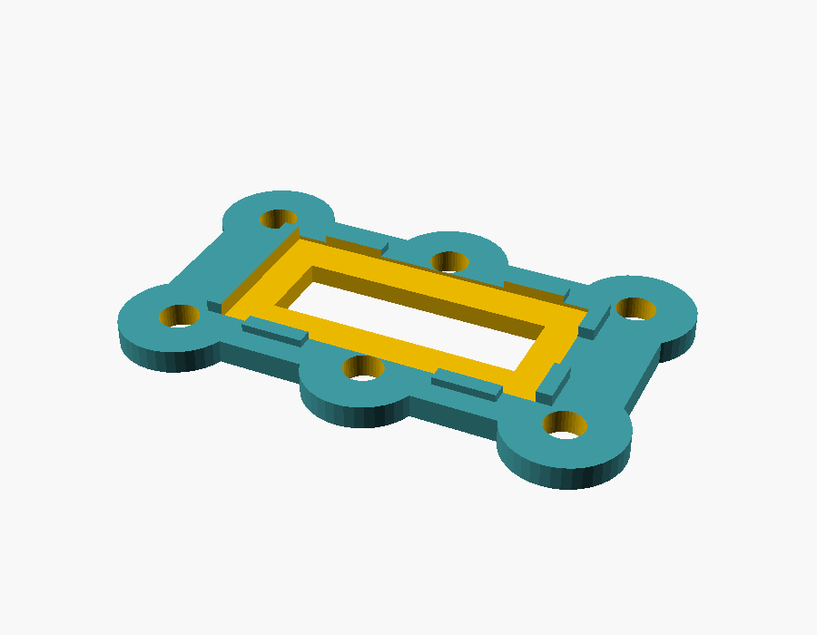 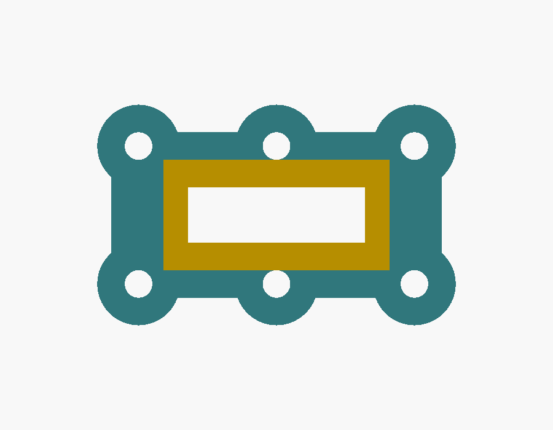 |
| **Kleine plaat** (4 pengaten) | [`smallplate.stl`](design/smallplate.stl) = `smallplate()` | 40 × 40 × 4,5 |  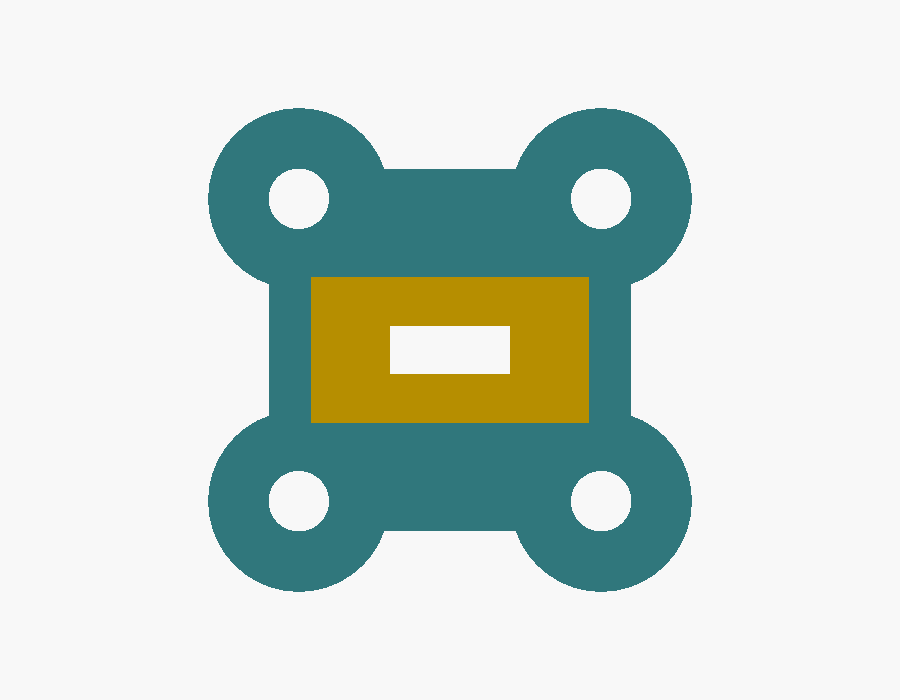 |
| **Rotor** (schijf) | [`rotor.stl`](design/rotor.stl) = `rotor()` | Ø 50 × 7 | 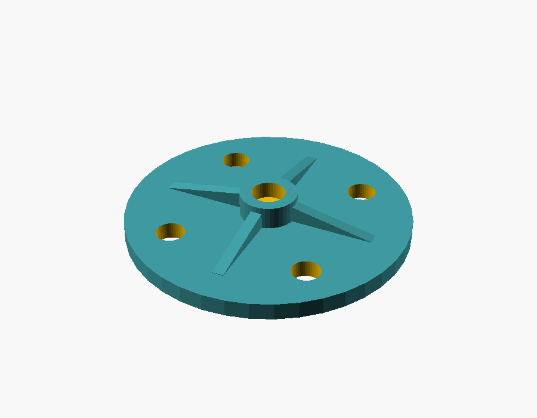 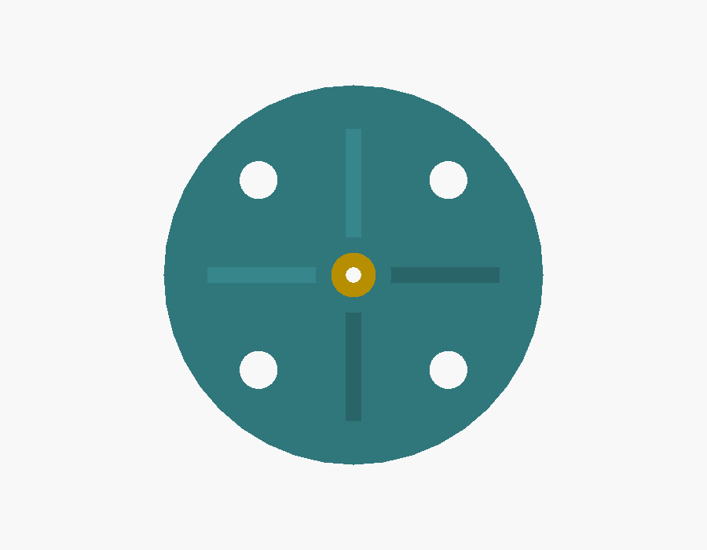 |
| **Kleine rotor** (balk) | [`smallrotor.stl`](design/smallrotor.stl) = `smallrotor()` | 40 × 15 × 6 |   |

(GitHub toont de STL-bestanden in een interactieve 3D-viewer als u erop klikt.)

Maten uit het SCAD-bestand:

- **Plaat:** zes pengaten Ø 5 mm met 25 mm steek (x = −25, 0, 25; y = ±12,5). Er zit een sleuf van **32 × 10 mm** door de plaat. Eromheen zit een uitsparing van **41 × 20 mm** (0,5 mm diep in de bovenkant), omgeven door kleine randjes (tot 1,5 mm boven de plaat) die de montageflens van de servo plaatsen.
- **Kleine plaat:** vier pengaten Ø 5 mm op een vierkant van 25 × 25 mm, een kleinere uitsparing (23 × 12 mm) met randjes, en een sleuf van 10 × 4 mm.
- **Rotor:** schijf Ø 50 mm met vier gaten Ø 5 mm op hetzelfde vierkant van 25 × 25 mm als de kleine plaat, een centrale naaf (Ø 10, 4 mm boven de schijf) met een opening van Ø 5,9 mm, een schroefgat van Ø 2 mm en vier dunne ribben aan de bovenkant.
- **Kleine rotor:** een balk met twee pengaten Ø 5 mm op 25 mm afstand, een centrale naaf (Ø 8, 3 mm boven de balk) met een opening van Ø 4,9 mm en een schroefgat van Ø 2 mm.

**Gebruikt in de standaardset:** de **kleine plaat** van 40 × 40 mm (`smallplate.stl`), aan de servo gelijmd, en de **kleine rotor** (`smallrotor.stl`), in plaats van een hoorn op de uitgaande as geschroefd (zie [§3.7](#37-servomodules-voorbereiden-en-onderhouden)). De grotere plaat van 65 × 40 mm (`bottomplate.stl`) en de ronde rotor (`rotor.stl`) staan als alternatieven in de repository.

### 4.3 Montage en bedrading

#### Besturingskastje

1. Monteer de Mega ADK in de Hammond-behuizing (bij de behuizing zitten schroeven en de onderdelen om het bordje vast te zetten).
2. Soldeer de pinheaders van 3 × 4 voor **kanaal 0–7** op het Adafruit-shield (de meegeleverde headers zijn niet gemonteerd). Steek het shield op de Mega. Het shield gebruikt alleen **SDA/SCL (I2C)**; I2C-adres **0x40** (standaard, geen soldeerbruggen gesloten).
3. Sluit het kastje. Via sleuven in de behuizing zijn de USB-A-hostaansluiting, de USB-B-aansluiting, de DC-jack en de servoheaders bereikbaar.

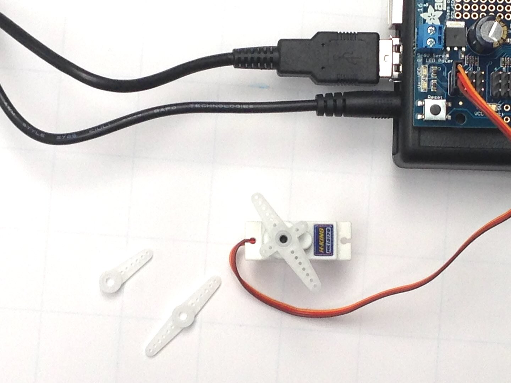

Op het shield heeft elke 3-polige header drie rijen met de labels **PWM**, **V+** en **GND**. De servostekker gaat erop met de signaaldraad (oranje/geel) op de PWM-rij, rood op V+, bruin/zwart op GND.

#### Kanaaltoewijzing in de firmware

| Kanaal op het shield | Servo | Schuifknop / draaiknop / R-M-S-knoppen |
|:---:|---|:---:|
| 0 … 7 | 1 … 8 | 1 … 8 (van links naar rechts) |
| 8 … 15 | niet gebruikt | — |

#### Korg nanoKONTROL2 instellen (en de LED-modus terugzetten)

De firmware laat de knoppen van het paneel zelf branden. Zo is te zien welke kanalen voor opname zijn gewapend (R), welke gedempt zijn of solo staan, of het station opneemt (●) of afspeelt (▶), en of CYCLE aan staat. Daarvoor moet het paneel op **LED Mode = External** staan. Staat het paneel op *Internal*, dan laat het de knoppen zelf branden en laten de lampjes niet meer zien wat het station doet.

**Het paneel valt soms terug op de fabrieksinstelling (LED Mode *Internal*).** Dit is een terugkerende technicustaak: als de knoppen niet meer branden zoals verwacht, zet u het als volgt terug. Het kost een paar minuten en er is een computer voor nodig.

**Programma:** de gratis **KORG KONTROL Editor** (Windows en macOS). Download hem via de [nanoKONTROL2-pagina op korg.com](https://www.korg.com/us/products/computergear/nanokontrol2/) (knop *Download KORG KONTROL Editor*). Op het moment van schrijven is de huidige versie 2.5.1.

**Werkwijze**

1. Haal de nanoKONTROL2 los van het besturingskastje en sluit hem met zijn USB-kabel rechtstreeks op de computer aan. (De editor kan niet via de Arduino met het paneel praten.)
2. Start de **KORG KONTROL Editor**. Kies, als daarom wordt gevraagd, **nanoKONTROL2** als apparaat.
3. Open het tabblad **CONTROL** en kies bovenaan de lijst links **Common**.
4. Stel rechts in:
   - **Global MIDI Channel = 1**
   - **Control Mode = CC**
   - **LED Mode = External**
5. Kies in het menu **Communication → Write Scene Data** en bevestig. De instellingen komen pas op dit moment in het paneel; in de titel van de editor kan nog "Untitled" staan.
6. Sluit de editor en haal het paneel los van de computer.
7. Sluit het paneel weer aan op het besturingskastje. Controle: druk op een **R**-knop, die moet gaan branden en blijven branden; druk op **●**, die moet branden tijdens het opnemen.

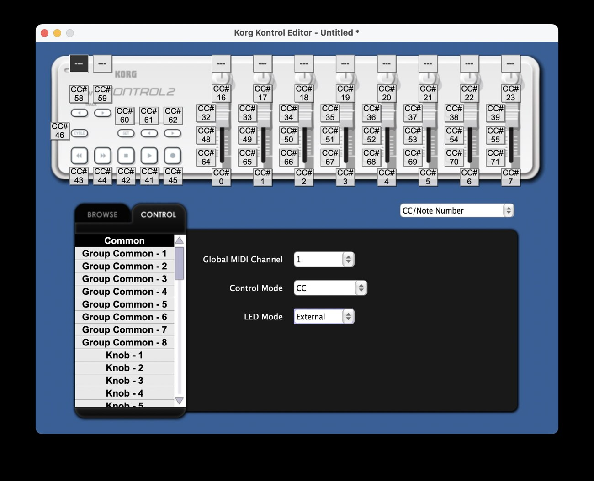

*Het venster van de editor met de juiste instellingen. De kleine labels op het paneelplaatje zijn de CC-nummers; dit zijn de fabrieksnummers die de firmware verwacht (vergelijk met de tabel in [§4.5](#45-hoe-de-firmware-werkt)). Wijken er een paar af, dan is het paneel aangepast of staat het niet in CC-modus.*

Als de LED's na enige tijd weer terugvallen, herhaalt u gewoon de werkwijze. Controleer dit één keer als onderdeel van de test vóór de workshop (§4.7).

#### Voeding

- Alles draait op één **5 V USB-voeding**, met de USB-A naar DC-kabel aangesloten op de **DC-jack** van de Arduino.
- **Servovoeding:** een draad aan de onderkant van het servoshield verbindt de **Vin**-pin van de Arduino met de **V+-ingang** van het shield. De blauwe schroefklem op het shield wordt daarom niet gebruikt, en de servo's krijgen dezelfde 5 V als de Arduino. De servostroom loopt via de DC-jack en het Vin-pad van de Arduino.
- ⚠ **Gebruik nooit een voeding met meer dan 5 V.** Omdat Vin met V+ is verbonden, zou een voeding van 7–12 V (wat Arduino normaal aanbeveelt voor de DC-jack) die spanning op de servo's zetten. De servorail van het shield is gespecificeerd tot 6 V.
- Het kastje alleen via de **USB-B-aansluiting** voeden (bijvoorbeeld tijdens het programmeren) voedt Vin niet, dus de servo's krijgen op die manier geen stroom. Dat is prima voor firmware uploaden en de seriële monitor lezen; laat de servo's losgekoppeld of accepteer dat ze niet bewegen.
- Arduino geeft voor de DC-jack 7–12 V op; bij minder dan 7 V kan de spanningsregelaar op het bord minder dan 5 V leveren. De bestaande stations draaien zo. Ziet u willekeurige resets of valt het paneel weg als veel servo's bewegen, verdenk dan eerst de voeding: gebruik de originele 2,1 A-voeding en een korte, goede voedingskabel.
- De nanoKONTROL2 neemt minder dan 100 mA op uit de USB-hostaansluiting.

### 4.4 Firmware (PlatformIO)

Dit is een [PlatformIO](https://platformio.org/)-project voor VS Code.

```text
platformio.ini      board = megaADK, bibliotheken, build flags
src/main.cpp        de firmware (port van arduino/servoRecorder/servoRecorder.ino)
```

**Bouwen en uploaden**

1. Installeer VS Code en de extensie *PlatformIO IDE*.
2. Open deze map. PlatformIO downloadt de toolchain en de bibliotheken uit `platformio.ini`:
   - [USB Host Shield Library 2.0](https://github.com/felis/USB_Host_Shield_2.0) (tag 1.7.0), met daarin de klasse `usbh_midi`
   - [Adafruit PWM Servo Driver Library](https://github.com/adafruit/Adafruit-PWM-Servo-Driver-Library) (3.x) en [Adafruit BusIO](https://github.com/adafruit/Adafruit_BusIO)
3. Sluit de USB-B-aansluiting van de Mega ADK aan op de computer. **Build** (✓) en **Upload** (→), of op de opdrachtregel `pio run -t upload`.
4. **Seriële monitor** (115200 baud): `pio device monitor`. Hij toont elk MIDI-bericht van het paneel (`controller,waarde`) en de waarden die naar de servo's gaan.

**Build flags** (in `platformio.ini`)

| Flag | Betekenis |
|---|---|
| `-DBOARD_MEGA_ADK` | Vertelt de USB-hostbibliotheek dat de MAX3421E op het bord zit (standaard aan). |
| `-DXTOUCH` | Behringer X-Touch-variant (stapknoppen reageren op elke waarde ongelijk aan nul). |
| `-DNO_SERVOSHIELD` | Stuur 8 servo's rechtstreeks aan met `Servo.h` op pin 24–31 in plaats van via het PWM-shield. |

**Wijzigingen ten opzichte van de originele Arduino IDE-sketch**

- `#include <Arduino.h>` en functieprototypes toegevoegd (de Arduino IDE doet dit automatisch, PlatformIO niet).
- Losse `;` na `#endif` verwijderd.
- `MIDI Midi(&Usb);` werd `USBH_MIDI Midi(&Usb);` omdat de klasse in de bibliotheek een andere naam heeft gekregen.
- `XTOUCH` en `SERVOSHIELD` kunnen worden ingesteld vanuit `platformio.ini`.
- Er wordt een bericht op de seriële poort gezet als de USB-host niet start.

Functioneel gedraagt de firmware zich als het origineel.

**Buildcontrole:** de port is gecompileerd en gelinkt met avr-gcc tegen de Arduino AVR-core 1.8.8 en bovenstaande bibliotheken, voor de varianten standaard, `XTOUCH` en `NO_SERVOSHIELD`. Het flashgebruik was ongeveer 20 kB (7,8 %). Het statische RAM-gebruik was 7.325 van 8.192 bytes (89 %). De auteur van deze port heeft hem niet op hardware gedraaid; draai hem dus één keer op een station en controleer de seriële monitor.

#### Alternatief: compileren en uploaden met de Arduino IDE (de klassieke route)

PlatformIO is niet verplicht. Dezelfde firmware is ook beschikbaar als Arduino IDE-sketch in [`arduino/animationstation/animationstation.ino`](arduino/animationstation/animationstation.ino). Dit is een kopie van `src/main.cpp` (dat is het hoofdexemplaar; `tools/sync_sketch.sh` ververst de kopie na wijzigingen).

> **Gebruik de oude sketch** `arduino/servoRecorder/servoRecorder.ino` **niet** met de huidige bibliotheken. Die gebruikt de oude klassenaam `MIDI`, die de huidige USB Host Shield-bibliotheek niet meer heeft. In de nieuwe sketch is die ene wijziging doorgevoerd.

1. Installeer de [Arduino IDE](https://www.arduino.cc/en/software) (2.x; 1.8.x werkt ook).
2. Open de sketch: **File → Open…** en kies `arduino/animationstation/animationstation.ino`. Laat de sketch in zijn map staan (de mapnaam moet gelijk zijn aan de bestandsnaam).
3. Installeer de bibliotheken: **Sketch → Include Library → Manage Libraries…** (of het bibliotheekicoon links in IDE 2.x). Zoek en installeer:
   - **USB Host Shield Library 2.0** (auteurs Oleg Mazurov, Kristian Sloth Lauszus en anderen), versie 1.7.0 of nieuwer. Hierin zit `usbh_midi`.
   - **Adafruit PWM Servo Driver Library** (3.0.x). Als de IDE vraagt of de afhankelijkheden ook geïnstalleerd moeten worden, kies dan **Install all**; dat voegt **Adafruit BusIO** toe. Wordt dat niet gevraagd, zoek dan zelf naar *Adafruit BusIO* en installeer die.
   - `Wire` en `SPI` zitten in de IDE.
4. Kies het board: **Tools → Board → Arduino AVR Boards → Arduino Mega ADK**. Het moet echt de *Mega ADK* zijn (niet "Arduino Mega or Mega 2560"), want dan gebruikt de USB-hostbibliotheek de pinnen van de ingebouwde USB-chip van de ADK.
5. Sluit de **USB-B**-aansluiting van de Mega ADK aan op de computer en kies de poort onder **Tools → Port**. (Onder Linux moet uw gebruiker mogelijk in de groep `dialout` zitten.)
6. Klik op **Verify** (✓) om te compileren en daarna op **Upload** (→).
7. Open de **Serial Monitor** (**Tools → Serial Monitor**) op **115200 baud**. Als u een schuifknop beweegt, ziet u de MIDI-nummers.

De IDE kent geen build flags. Om de opties uit `platformio.ini` te gebruiken, past u bovenin de sketch aan: haal de `//` weg voor `//#define XTOUCH`, of zet de regel `#define NO_SERVOSHIELD` boven `#ifndef NO_SERVOSHIELD`.

*Gecontroleerd:* de sketch compileert en linkt voor het Mega ADK-board met de Arduino AVR-core 1.8.8 en bovenstaande bibliotheken, zonder extra flags (zelfde grootte als de PlatformIO-build). Hij is niet in de IDE zelf uitgeprobeerd. Bedenk dat het kastje alleen via USB-B voeden de servo's geen stroom geeft (§4.3, *Power* / *Voeding*).

### 4.5 Hoe de firmware werkt

**Lus.** Elke 50 ms (`LOOPDELAY`, 20 Hz) kijkt de firmware naar de huidige stand en schrijft zo nodig de servo's. Daartussen worden de USB-stack en het paneel continu uitgelezen.

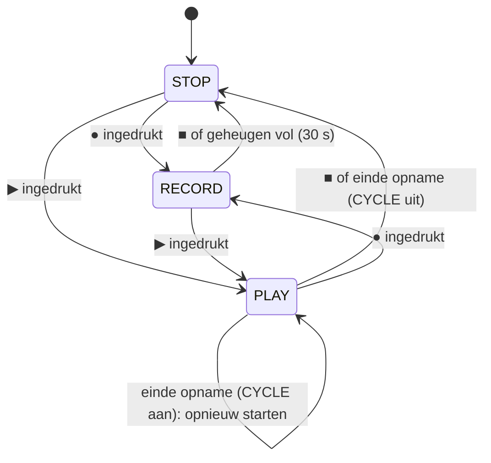

**Geheugen.** Eén opname staat in een RAM-array van 600 stappen (`MAX_STEPS`). Elke stap is 10 bytes: een 16-bit tijdstempel (in eenheden van 50 ms) en 8 servowaarden (0–127). Dat is 6.000 bytes van de 8 KB van de Mega, dus er is ruimte voor slechts zo'n 80 stappen extra voordat de stack gevaar loopt. Voor langere opnames kunt u beter de bemonsteringssnelheid verlagen (`LOOPDELAY` verhogen).

**Servopositie.** Voor elke servo: `waarde = schuifknop − draaiknop` (bereik −127 … 127), afgebeeld op een PWM-waarde tussen `SERVOMIN` (150) en `SERVOMAX` (480) van de 4096 bij 50 Hz. Met de prescaler van de Adafruit-bibliotheek geeft dit een tik van ongeveer 4,88 µs, dus de nominale puls is ongeveer **0,73 ms … 2,34 ms** (midden 1,54 ms). De werkelijke waarden hangen af van de interne oscillator van de PCA9685.

Omdat het bereik van de schuifknop 0…127 is en de draaiknop wordt afgetrokken, **bestrijkt een schuifknop maar de helft van het volledige pulsbereik, en kiest de draaiknop welke helft**:

| Draaiknop | Schuifknop doorloopt waarden | Nominale puls |
|---|---|---|
| geheel links (0) | 315 … 480 | 1,54 … 2,34 ms |
| midden (64) | 231 … 396 | 1,13 … 1,93 ms |
| geheel rechts (127) | 150 … 315 | 0,73 … 1,54 ms |

Pas `SERVOMIN` / `SERVOMAX` aan om de slag te veranderen (kalibreer op één servo met de seriële monitor open). De waarde 0 naar een kanaal schrijven schakelt zijn uitgang uit; zo worden servo's slap gemaakt.

**Rusttijd.** In STOP-stand wordt, als er langer dan `TIMEOUT` lussen (10 × 50 ms) niets is veranderd, `stop()` aangeroepen, wat alle uitgangen uitschakelt. `stop()` wordt ook aan het eind van een opname aangeroepen (CYCLE uit).

**Opnemen.** Alle stappen worden met een tijdstempel geschreven. Alleen servo's met **R** gewapend worden geschreven. Als er nog 5 s geheugen over is, knippert het ●-lampje; aan het einde van het geheugen stopt de opname vanzelf.

**Afspelen.** De volgende stap wordt uitgevoerd als zijn tijdstempel is verstreken. Het einde van een opname wordt herkend aan een stap met tijdstempel 0 (zie §4.6).

**Controlenummers van het paneel** (fabrieks-CC-modus van de nanoKONTROL2, kanaal 1):

| Bediening | CC-nummer |
|---|---|
| Schuifknoppen 1–8 | 0–7 |
| Draaiknoppen 1–8 | 16–23 |
| S (solo) 1–8 | 32–39 |
| M (mute) 1–8 | 48–55 |
| R (opname-arm) 1–8 | 64–71 |
| ▶ afspelen | 41 |
| ■ stop | 42 |
| ◄◄ stap terug | 43 |
| ►► stap vooruit | 44 |
| ● opnemen | 45 |
| CYCLE | 46 |
| TRACK ◄ / ► | 58 / 59 (geteld in de variabele `page`, verder ongebruikt) |

De firmware stuurt dezelfde CC-nummers met waarde 127 of 0 terug naar het paneel om de knoppen te laten branden of te doven.

**Seriële debuguitvoer** (115200 baud): `controller,waarde` voor elk ontvangen MIDI-bericht; tijdens opnemen/afspelen/stappen één regel per frame met het stapnummer, de tijdstempel en de 8 servowaarden (`-` voor gedempte servo's).

**Andere controllers.** De oudere varianten (APC mini, APC mini op DUE en Teensy, MIDIMIX, Braccio) maken geen deel uit van deze port. Ze staan in de oorspronkelijke repositorymap `arduino/servoRecorder/other versions/`.

### 4.6 Bekende beperkingen van de huidige firmware

Deze volgen uit het lezen van de code. Ze zijn zoals in het origineel gelaten, zodat de port zich hetzelfde gedraagt; het zijn goede kandidaten voor de volgende versie.

1. **Een kortere nieuwe opname houdt de oude staart.** Het einde van een opname wordt herkend aan een tijdstempel 0 in de volgende stap. Na het opnemen wordt geen eindmarkering geschreven, dus als een nieuwe opname korter is dan de oude, blijven de oude stappen afspelen. Oplossingsidee: schrijf `set[memoryCounter].time = 0` als het opnemen stopt.
2. **Niet-gewapende servo's houden oude gegevens.** Servo's met R uit worden tijdens het opnemen niet geschreven; bij afspelen krijgen ze wat er in het geheugen staat (0 na het opstarten).
3. **Posities van schuif- en draaiknoppen zijn bij het opstarten onbekend.** Het paneel meldt ze niet; alle waarden beginnen op 0 tot ze bewogen worden. Oplossingsidee: de toestand van het paneel opvragen of servo's negeren die nog niet zijn aangeraakt.
4. **Buffer te ver uitgelezen.** Stap vooruit (►►) en de test op het einde van de opname kunnen één stap voorbij de array lezen (`set[MAX_STEPS]`).
5. **Solo werkt alleen bij afspelen en stappen**, niet bij live bediening.
6. **`page` / TRACK-knoppen** doen niets.
7. **`(int)(millis() - starttime)` bij opnemen** loopt na ongeveer 32,7 s over. Dit is onschadelijk zolang `MAX_STEPS × LOOPDELAY` daaronder blijft. Houd hier rekening mee als u de opname verlengt.
8. `pinMode(7, OUTPUT); digitalWrite(7, HIGH);` is een oude work-around voor USB-hostshields die geen ADK zijn. De reset van de MAX3421E op de Mega ADK zit op een interne pin die de bibliotheek afhandelt, dus deze regel is onschadelijk maar overbodig.

### 4.7 Onderhoud en reparatie

**Vóór elke workshop (5 minuten)**

- Zet aan, controleer of het paneel reageert en of de lampjes werken: druk op een R-knop en op ● en kijk of ze branden (zo niet, zet de LED-modus terug, §4.3).
- Beweeg alle schuif- en draaiknoppen en test daarna alle 8 servokanalen met een reserveservo.
- Controleer kabels, stekkers, rotorschroeven en vastgelijmde basisplaten op elke servomodule; repareer of vervang beschadigde (§3.7).
- Controleer dat het kastje en het paneel schoon zijn en er geen losse splitpennen zijn.

**Veelvoorkomende reparaties**

| Probleem | Reparatie |
|---|---|
| Servo dood of tandwielen kapot | Vervang de servomodule (bewaar reserves, §4.1). Bouw een nieuwe met lijm en rotor zoals in §3.7, met de servo in zijn middenstand. |
| Rotor los of wiebelt | Monteer de rotor opnieuw, zo nodig met een grotere schroef (§3.7). |
| Basisplaat los | Lijm opnieuw vast met hotmelt-lijm (§3.7). |
| Gebarsten geprinte plaat | Print opnieuw uit de STL (3 mm dik, randjes slechts 1–1,5 mm hoog). |
| Kapot servosnoer | Vervang de verlengkabel. |
| Knoppen van het paneel branden niet, of de lampjes komen niet overeen met wat het station doet | Het paneel is teruggevallen op LED Mode *Internal*. Zet hem weer op *External* met de KORG KONTROL Editor (§4.3), en vergeet *Communication → Write Scene Data* niet. |
| Paneel niet herkend | Probeer een andere USB-kabel. Kijk in de seriële uitvoer naar `USB host (MAX3421E) init failed`. Flash de firmware opnieuw. |
| Firmware kwijt of beschadigd | Upload opnieuw vanuit PlatformIO (§4.4). |
| Willekeurige resets | Controleer de 5 V-voeding en kabel (§4.3, *Voeding*). Vervang hem niet door een voeding met hogere spanning. |

**De Arduino of het shield vervangen:** upload de firmware, steek het shield opnieuw erop en controleer de volgorde van de servokanalen aan de hand van §4.3.

### 4.8 Indeling van de repository

```text
README.md                handleiding (Engels)
README.nl.md             deze handleiding (Nederlands)
platformio.ini           PlatformIO-project (Arduino Mega ADK)
src/main.cpp             firmware
design/                  OpenSCAD-bron, STL-bestanden, gerenderde afbeeldingen, renderscript
docs/images/             foto's (systeem, servo-aansluiting, onderdelen, KONTROL Editor)
docs/quickcard-nl/       originele Nederlandse instructiekaart (PDF, Word, ePub)
arduino/animationstation/  Arduino IDE-sketch (kopie van src/main.cpp)
arduino/servoRecorder/   originele Arduino IDE-sketch en varianten voor andere panelen (oude bibliotheeknamen)
tools/sync_sketch.sh     kopieert src/main.cpp naar de Arduino IDE-sketch
```

### Dankbetuiging en licenties

- Firmware gebaseerd op het voorbeeld *USB-MIDI to Legacy Serial MIDI converter* van Yuuichi Akagawa (idee van de LPK25-converter van Collin Cunningham) en het Adafruit PWM Servo Driver-voorbeeld van Limor Fried / Ladyada.
- Bibliotheken: [USB Host Shield 2.0](https://github.com/felis/USB_Host_Shield_2.0) (GPL-2.0), [Adafruit PWM Servo Driver](https://github.com/adafruit/Adafruit-PWM-Servo-Driver-Library) en [Adafruit BusIO](https://github.com/adafruit/Adafruit_BusIO) (BSD).
- **Licentie van deze repository: nog niet gekozen.** Let op dat de USB Host Shield-bibliotheek GPL is, wat van toepassing is als u gecompileerde firmware verspreidt.
